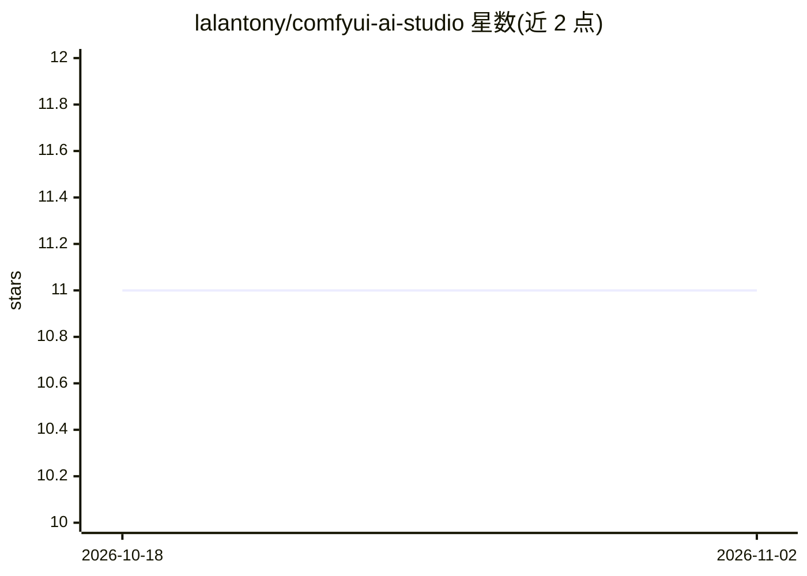

# lalantony/comfyui-ai-studio

⭐ 11 · TypeScript · MIT · 推送 2026-05-03 · [GitHub](https://github.com/lalantony/comfyui-ai-studio) · 个人维护

**面向创作者的本地 ComfyUI 工作室：链式编排多次生成流水线**

基于 Next.js/React Flow 的本地优先创作工作区，连接用户已有 ComfyUI 服务器（本地或远程），把 workflow_api.json 注册为端点并自动内省输入输出。核心机制：多阶段 ComfyUI 链式执行（单次运行串联多个工作流、逐阶段自动入库、可从失败步骤恢复）、拓扑排序 DAG 运行时与 SSE 事件总线、文件系统即唯一数据源（无数据库）。附带 LLM provider 注入（OpenAI 兼容 + Anthropic）用于提示词节点。需 Node.js ≥22 与运行中的 ComfyUI 实例，从源码安装运行。

## 筛选速览

| 维度 | 判定 | 备注 |
|---|---|---|
| AI 角色 | `ai-native` | 本体是模型或模型工具 |
| 许可风险 | `permissive` | MIT |
| 部署形态 | `None` |  |
| 模型依赖 | local-ok | 支持本地模型 |
| 硬件要求 | — | 无带数字的原话,不猜 |
| 安装摩擦 | `low` | 无编译、无系统依赖或容器化 |
| 成熟度 | — | 结构信号不足 |

## 能力要点

- 多阶段 ComfyUI 链：单次运行串联多个工作流，逐阶段保存产物并可从失败步骤恢复
- 自动内省 workflow_api.json 输入/输出并做运行前输入校验
- DAG 运行时 + SSE 事件总线 + WebSocket 心跳重连与重试退避
- LLM provider 即插即用（OpenAI 兼容 + 原生 Anthropic），流式输出进提示词节点

## 适用场景

- 把多个 ComfyUI 工作流串成一条生成流水线并逐阶段跟踪产物
- 按创作项目组织素材、提示词与运行历史
- 在本地文件系统上管理资产，不依赖云端与数据库

## 场景标签

`图像生成` `视频生成` `工作流自动化` · 领域:效率与自动化

## 证据(README 行号)

> L16: ComfyUI is the most capable local-first generation engine in the AI ecosystem — but its node graph is a workshop, n
> L24: - 🔗 **Multi-stage ComfyUI chains** — wire `ComfyUI A → ComfyUI B → …` as a single run. Every stage's output auto-sa

## 星数曲线

2026-10-18 11 → 2026-11-02 11（+0）

---
*卡片 v1 · prompt 1.4 · 生成 2026-11-02 · 置信度 high · 依据 README sha `4659eb13ae34` · [字段定义](../../DATASET.md)*
