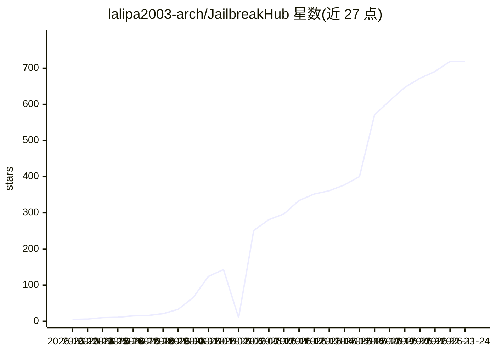

# lalipa2003-arch/JailbreakHub

⭐ 744 · Roff · Unlicense · 推送 2026-11-20 · [GitHub](https://github.com/lalipa2003-arch/JailbreakHub) · 个人维护

**面向 LLM 越狱研究的提示词与技术收集清单**

一个从 Reddit、Discord 服务器收集并由维护者自行补充的提示词、技术与手法清单，收录用于探测 LLM 对齐与安全过滤器的提示注入向量、社工模式与上下文构造技巧，声明聚焦 2026 年条目而非 2023-2025 旧内容。附免责声明：维护者不对账号封禁负责，不鼓励恶意活动，且列出的提示仅适用于各家官方渠道。

## 筛选速览

| 维度 | 判定 | 备注 |
|---|---|---|
| AI 角色 | `ai-knowledge` | 知识聚合/清单类 |
| 许可风险 | `permissive` | Unlicense |
| 部署形态 | `None` |  |
| 模型依赖 | — | README 未给出锁定关系 |
| 硬件要求 | — | 无带数字的原话,不猜 |
| 安装摩擦 | `low` | 无编译、无系统依赖或容器化 |
| 成熟度 | — | 结构信号不足 |

## 能力要点

- 聚合来自 Reddit 与 Discord 的越狱提示词与手法
- 声明收录 2026 年的新条目
- 提供提示注入向量、社工模式、上下文构造三类内容

## 适用场景

- 研究 LLM 安全过滤器与对齐行为
- 收集越狱攻防相关的提示词样本

## 场景标签

 · 领域:AI 安全/对抗研究资料

## 证据(README 行号)

> L5: This is a curated collection of prompts, techniques, and methodologies. Collected from Reddit, Discord servers, and 
> L9: This hub provides known prompt injection vectors, social engineering patterns, and contextual framing techniques use

## 星数曲线

2026-10-22 5 → 2026-11-24 719（+714）

---
*卡片 v1 · prompt 1.4 · 生成 2026-11-24 · 置信度 mid · 依据 README sha `7c64e460c62a` · [字段定义](../../DATASET.md)*
