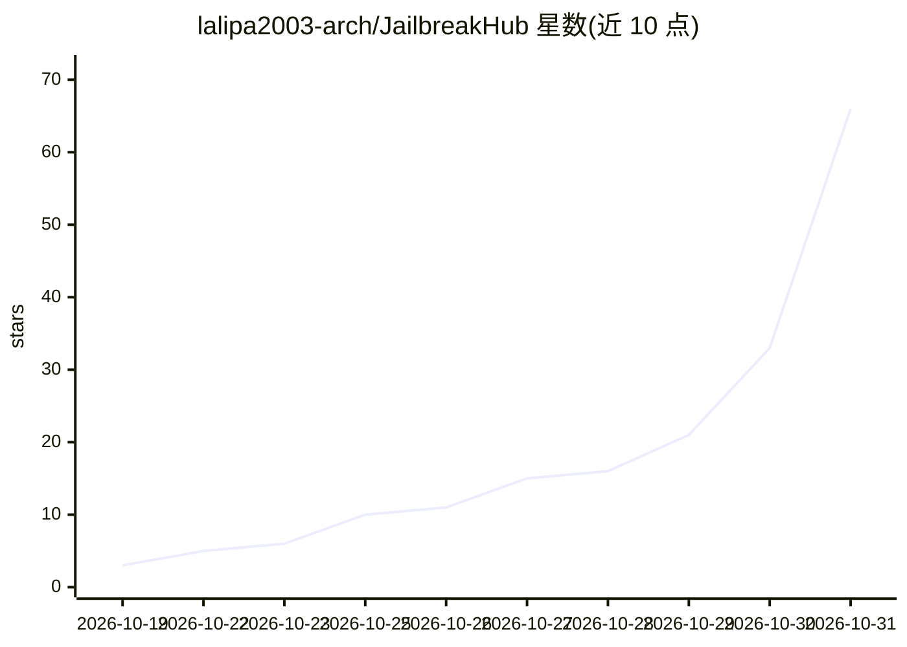

# lalipa2003-arch/JailbreakHub

⭐ 66 · Roff · Unlicense · 推送 2026-10-30 · [GitHub](https://github.com/lalipa2003-arch/JailbreakHub) · 个人维护

**LLM 越狱提示词与技术策展集合（2026 年）**

个人维护的 LLM 越狱（jailbreak）提示词、技术与方法论策展仓库。内容来源包括 Reddit、Discord 服务器及维护者自制，声称为 2026 年可用的提示词而非 2023-2025 旧集。README 列出的内容包括提示注入向量、社会工程模式与上下文框架技术，用于探测 LLM 对齐与安全过滤器；附免责声明称不鼓励恶意活动，维护者对账号被封不承担责任。仓库仅含文档集合，无代码或安装途径。

## 筛选速览

| 维度 | 判定 | 备注 |
|---|---|---|
| AI 角色 | `ai-knowledge` | 知识聚合/清单类 |
| 许可风险 | `permissive` | Unlicense |
| 部署形态 | `None` |  |
| 模型依赖 | — | README 未给出锁定关系 |
| 硬件要求 | — | 无带数字的原话,不猜 |
| 安装摩擦 | `low` | 无编译、无系统依赖或容器化 |
| 成熟度 | — | 结构信号不足 |

## 能力要点

- 聚合来自 Reddit、Discord 与自制的越狱提示词与技术
- 声明收录 2026 年可用提示词，非旧集
- 列出提示注入向量与社会工程模式类别

## 适用场景

- 查找用于探测 LLM 安全过滤器的提示词与技术
- 研究 LLM 对齐与越狱方法论的策展材料

## 场景标签

`精选清单` · 领域:学习与行业

## 证据(README 行号)

> L5: This is a curated collection of prompts, techniques, and methodologies. Collected from Reddit, Discord servers, and 
> L9: This hub provides known prompt injection vectors, social engineering patterns, and contextual framing techniques use

## 星数曲线

2026-10-19 3 → 2026-10-31 66（+63）

---
*卡片 v1 · prompt 1.4 · 生成 2026-10-28 · 置信度 mid · 依据 README sha `fa4eead26c19` · [字段定义](../../DATASET.md)*
