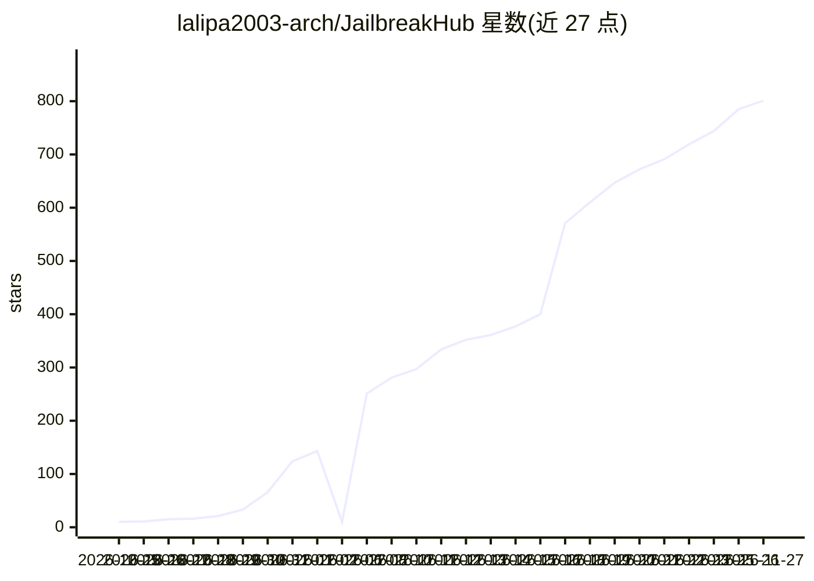

# lalipa2003-arch/JailbreakHub

⭐ 801 · Roff · Unlicense · 推送 2026-11-25 · [GitHub](https://github.com/lalipa2003-arch/JailbreakHub) · 个人维护

**面向研究者的 LLM 越狱提示词与技术方法合集**

一个策展式合集仓库，收录用于探测 LLM 对齐机制与安全过滤器的提示注入向量、社会工程模式与上下文框架技术。内容来源包括 Reddit、Discord 服务器以及维护者自创条目，定位为 2026 年的有效提示词而非旧年份合集。README 提供免责声明：维护者不对账号封禁负责，不鼓励恶意活动，且提示词仅适用于官方渠道。维护者为个人，另维护一个公共代理列表项目。

## 筛选速览

| 维度 | 判定 | 备注 |
|---|---|---|
| AI 角色 | `ai-knowledge` | 知识聚合/清单类 |
| 许可风险 | `permissive` | Unlicense |
| 部署形态 | `None` |  |
| 模型依赖 | — | README 未给出锁定关系 |
| 硬件要求 | — | 无带数字的原话,不猜 |
| 安装摩擦 | `low` | 无编译、无系统依赖或容器化 |
| 成熟度 | — | 结构信号不足 |

## 能力要点

- 收录提示注入向量、社会工程模式与上下文框架技术
- 来源包括 Reddit、Discord 服务器与维护者自创
- 声明内容针对 2026 年有效的提示词
- 附带账号封禁风险与使用范围的免责声明

## 适用场景

- 研究 LLM 安全过滤器可被探测的方式
- 了解提示注入与社会工程手法的现有分类
- 安全研究场景下查阅越狱技术方法集合

## 场景标签

`网络安全` · 领域:学习与行业

## 证据(README 行号)

> L5: This is a curated collection of prompts, techniques, and methodologies. Collected from Reddit, Discord servers, and 
> L9: This hub provides known prompt injection vectors, social engineering patterns, and contextual framing techniques use

## 星数曲线

2026-10-25 10 → 2026-11-27 801（+791）

---
*卡片 v1 · prompt 1.4 · 生成 2026-11-26 · 置信度 mid · 依据 README sha `b1797ca64fb2` · [字段定义](../../DATASET.md)*
