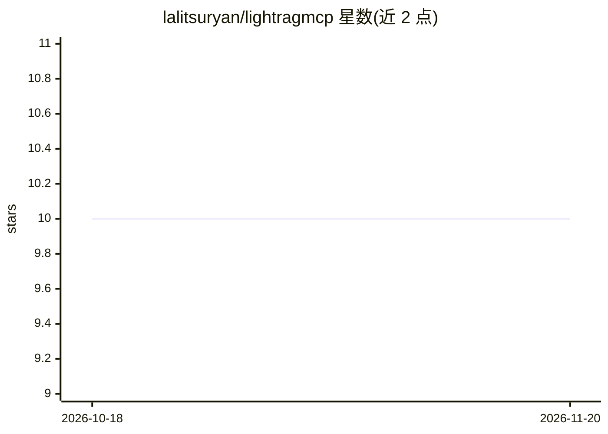

# lalitsuryan/lightragmcp

⭐ 10 · Python · MIT · 推送 2025-12-23 · [GitHub](https://github.com/lalitsuryan/lightragmcp) · 个人维护

**面向 MCP 客户端接入 LightRAG 的服务器，提供 30+ 工具**

将 LightRAG（RAG 与知识图谱系统）的 API 封装为 Model Context Protocol 服务器，提供 30 个工具，覆盖文档管理（插入/上传/扫描/删除）、查询（5 种模式、流式输出、带引用查询）、知识图谱操作（实体/关系的增删查改）与系统管理（健康检查、缓存清理等）。支持 Claude Desktop、Cline 等 MCP 客户端配置。运行依赖一个已启动的 LightRAG 服务器实例（1.4.9+），通过环境变量配置服务器 URL 与 API key。提供 npx/npm 与源码安装，另有 Python 与 TypeScript 双实现。

## 筛选速览

| 维度 | 判定 | 备注 |
|---|---|---|
| AI 角色 | `ai-ecosystem` | LLM/agent 周边工具 |
| 许可风险 | `permissive` | MIT |
| 部署形态 | `library` | 以包/库形式分发 |
| 模型依赖 | — | README 未给出锁定关系 |
| 硬件要求 | — | 无带数字的原话,不猜 |
| 安装摩擦 | `low` | 无编译、无系统依赖或容器化 |
| 成熟度 | — | 结构信号不足 |

## 能力要点

- 30 个 MCP 工具覆盖 LightRAG 的文档、查询、知识图谱与系统管理 API
- 5 种查询模式（naive/local/global/hybrid/mix）与流式输出、带引用查询
- npx 一条命令运行，另提供 npm 全局安装与源码构建
- Python 与 TypeScript 双实现（基于各自 MCP SDK）

## 适用场景

- 让 Claude Desktop / Cline 通过 MCP 直接操作 LightRAG 知识库
- 在 MCP 客户端中索引、上传并批量管理文档
- 通过自然语言交互查询知识图谱实体与关系

## 场景标签

`RAG` `知识图谱` · 领域:知识与检索

## 证据(README 行号)

> L3: A comprehensive Model Context Protocol (MCP) server for LightRAG - Simple and Fast Retrieval-Augmented Generation. T
> L7: LightRAG MCP Server provides complete integration with LightRAG's API, offering **30 fully working tools** for docum
> L531: - **MCP Client**: Compatible MCP client (Claude Desktop, Cline, etc.)

## 星数曲线

2026-10-18 10 → 2026-11-20 10（+0）

---
*卡片 v1 · prompt 1.4 · 生成 2026-11-19 · 置信度 mid · 依据 README sha `d262c8d5902a` · [字段定义](../../DATASET.md)*
