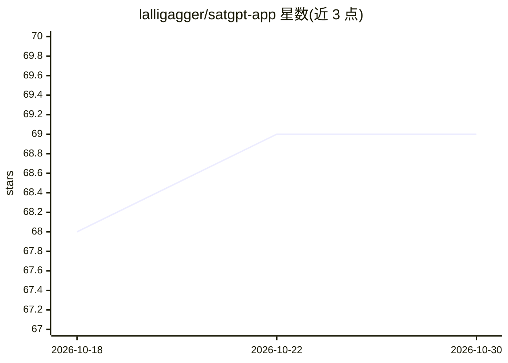

# lalligagger/satgpt-app

⭐ 69 · Python · MIT · 推送 2026-10-15 · [GitHub](https://github.com/lalligagger/satgpt-app) · [官网](https://kevinlalli.me/satgpt-app/) · 个人维护

**用自然语言检索查看卫星影像的 LLM agent 网页应用**

基于 LangChain 0.0.x + Panel 的 2023 年实验性 web 应用：用户以自然语言请求某地某时的影像，OpenAI 聊天模型（function calling）依次调用四个工具——STAC 搜索（Element84 Earth Search，Sentinel-2/Landsat）、地图绘制足迹、绘制元数据时间序列、以 odc-stac 惰性加载数据并打开查看器（光谱指数、云掩膜等）。代码保持 2023 年库版本可运行，依赖锁定文件重建；需 Python 3.11 与 OpenAI API key，本地 venv 运行。Landsat 需 requester-pays AWS 配置。

## 筛选速览

| 维度 | 判定 | 备注 |
|---|---|---|
| AI 角色 | `ai-native` | 本体是模型或模型工具 |
| 许可风险 | `permissive` | MIT |
| 部署形态 | `library` | 以包/库形式分发 |
| 模型依赖 | — | README 未给出锁定关系 |
| 硬件要求 | — | 无带数字的原话,不猜 |
| 安装摩擦 | `low` | 无编译、无系统依赖或容器化 |
| 成熟度 | `idea` | |

## 能力要点

- LLM agent 依次调用 stac_search/footprints/plot_metadata/show_datacube 四个工具
- Sentinel-2/Landsat 影像查看：光谱指数、色彩映射、百分位拉伸、云掩膜
- 2023 库版本锁定文件保持可运行，模型可经 SATGPT_MODEL 环境变量更换
- 提供静态录制的在线演示（无服务器无密钥）

## 适用场景

- 对话式查找并查看某地某时段的 Sentinel-2 卫星影像
- 绘制影像覆盖范围与云量等 STAC 元数据时间序列
- 计算并浏览光谱指数影像

## 场景标签

 · 领域:地球观测/地理空间应用

## 证据(README 行号)

> L7: SatGPT is an experiment in using a large language model to retrieve and look at satellite imagery in
> L25: Built on the OpenAI chat API (function calling), LangChain 0.0.x,
> L17: 1. `stac_search` — queries Element84 Earth Search v1 for

## 星数曲线

2026-10-18 68 → 2026-10-30 69（+1）

---
*卡片 v1 · prompt 1.4 · 生成 2026-10-24 · 置信度 high · 依据 README sha `b95cc39ea117` · [字段定义](../../DATASET.md)*
