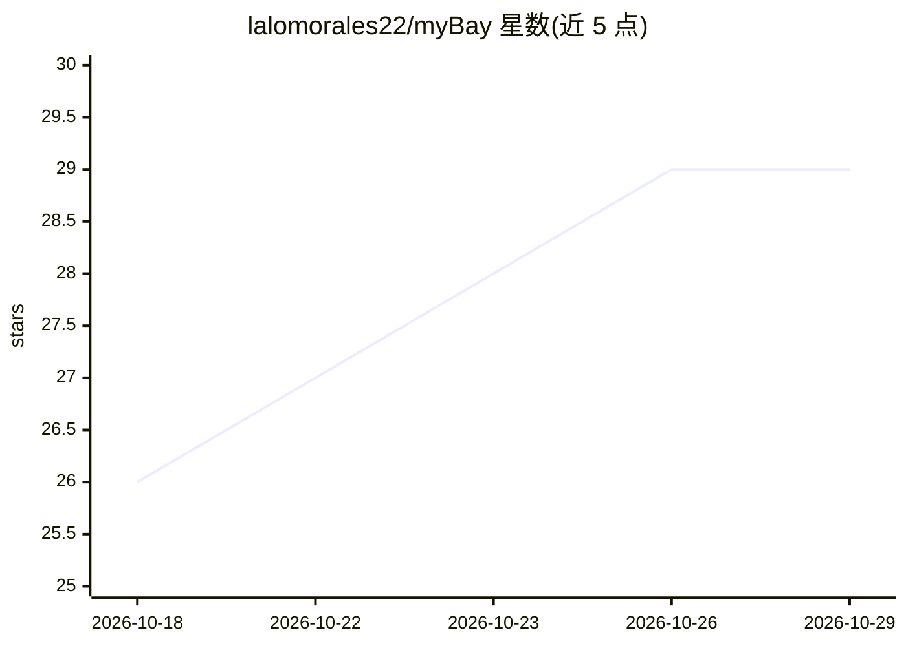

# lalomorales22/myBay

⭐ 29 · Python · MIT · 推送 2026-04-06 · [GitHub](https://github.com/lalomorales22/myBay) · 个人维护

**拍照自动生成并发布 eBay 商品 listings 的卖家工具**

面向 eBay 卖家的桌面应用：手机扫二维码拍照经 WiFi 传到桌面，AI（Ollama 本地或 OpenAI 云端）生成标题、描述、分类、成色与市场比价，一键发布到 eBay；支持 Turbo Mode 自动发布、离线队列、AI 抠图。附带 Admin 面板追踪支出、收入、里程与税务（Schedule C、SE tax），AI 助手可从自然语言记录交易。需配置 eBay 开发者 API 凭据；通过 git clone 与 install.sh 从源码安装，可选 PyInstaller 打包。

## 筛选速览

| 维度 | 判定 | 备注 |
|---|---|---|
| AI 角色 | `ai-native` | 本体是模型或模型工具 |
| 许可风险 | `permissive` | MIT |
| 部署形态 | `desktop` | 安装包/桌面程序 |
| 模型依赖 | local-ok | 支持本地模型 |
| 硬件要求 | — | 无带数字的原话,不猜 |
| 安装摩擦 | `low` | 无编译、无系统依赖或容器化 |
| 成熟度 | — | 结构信号不足 |

## 能力要点

- 手机拍照→AI 生成 listing→一键发布 eBay 的完整流程
- 双后端可选：Ollama 本地免费或 OpenAI 云端（含网搜定价）
- Turbo Mode 高置信度自动发布，30 秒可撤销
- Admin 面板：支出/收入/里程/税务追踪与自然语言记账

## 适用场景

- 批量把二手物品拍照快速上架 eBay
- 小卖家记账、算里程抵扣与税务汇总
- 本地 Ollama 隐私模式下零成本试用 AI 上架

## 场景标签

`AI 写作` `图像视频处理` · 领域:内容生成

## 证据(README 行号)

> L6: myBay turns photos into eBay listings in under 60 seconds. Snap photos on your phone, and AI creates the listing — t
> L60: 3. **AI analyzes** — Generates title, description, category, condition, and market price
> L35: |**Ollama** (local)|Free|Good — local vision model, fully private|`brew install ollama && ollama serve && ollama pu

## 星数曲线

2026-10-18 26 → 2026-10-29 29（+3）

---
*卡片 v1 · prompt 1.4 · 生成 2026-10-26 · 置信度 mid · 依据 README sha `d2613d8f200a` · [字段定义](../../DATASET.md)*
