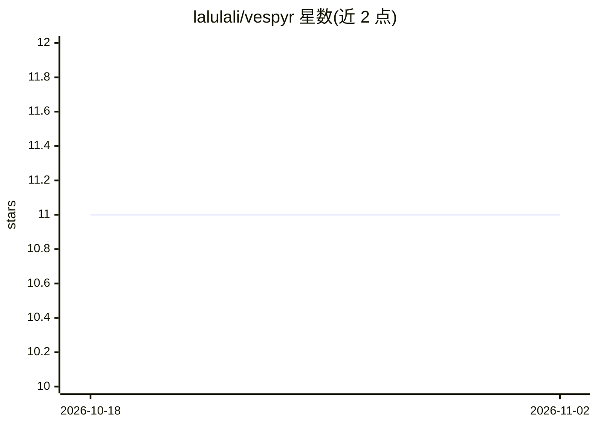

# lalulali/vespyr

⭐ 11 · JavaScript · MIT · 推送 2026-10-01 · [GitHub](https://github.com/lalulali/vespyr) · 个人维护 · 中文 README

**文件式多智能体引擎：向仓库安装 20 个协作 AI 角色**

跨平台、基于文件的多智能体引擎，通过 npm CLI 将 20 个专职 AI 角色（创始人、架构师、开发者、QA、安全工程师等）安装进项目仓库，各角色自行执行读写与命令。提供 3 层渐进式记忆、11 阶段强制流水线（validate→launch→retro）、41 个技能，以及 SHA-256 清单校验、供应链审计等完整性工具。支持 OpenCode、Claude Code、Kiro、GitHub Copilot 等多种 harness 安装，MIT 许可。

## 筛选速览

| 维度 | 判定 | 备注 |
|---|---|---|
| AI 角色 | `ai-ecosystem` | LLM/agent 周边工具 |
| 许可风险 | `permissive` | MIT |
| 部署形态 | `library` | 以包/库形式分发 |
| 模型依赖 | — | README 未给出锁定关系 |
| 硬件要求 | — | 无带数字的原话,不猜 |
| 安装摩擦 | `low` | 无编译、无系统依赖或容器化 |
| 成熟度 | — | 结构信号不足 |

## 能力要点

- 20 个专职 AI 角色与 @memory-controller 记忆服务
- 3 层渐进式记忆加载与会话间持久化
- 11 阶段带强制约束的流水线与 41 个技能
- SHA-256 清单校验、供应链审计等完整性工具（vespyr verify / audit）

## 适用场景

- 在仓库内搭建从想法验证到发布的 AI 协作团队
- 让 AI 角色执行设计、开发、评审、测试等分工任务
- 在 OpenCode、Claude Code、Copilot 等多种 harness 间复用同一套 agent 配置

## 场景标签

`多智能体` `编码 Agent` · 领域:Agent 开发

## 证据(README 行号)

> L5: **A platform-agnostic, file-based multi-agent engine.** Install 20 specialized AI personas directly into your reposi
> L80: **Agents act directly.** Every persona performs its own reads, writes, and command runs with its own tools; memory 

## 星数曲线

2026-10-18 11 → 2026-11-02 11（+0）

---
*卡片 v1 · prompt 1.4 · 生成 2026-11-02 · 置信度 high · 依据 README sha `c7c09f820db0` · [字段定义](../../DATASET.md)*
