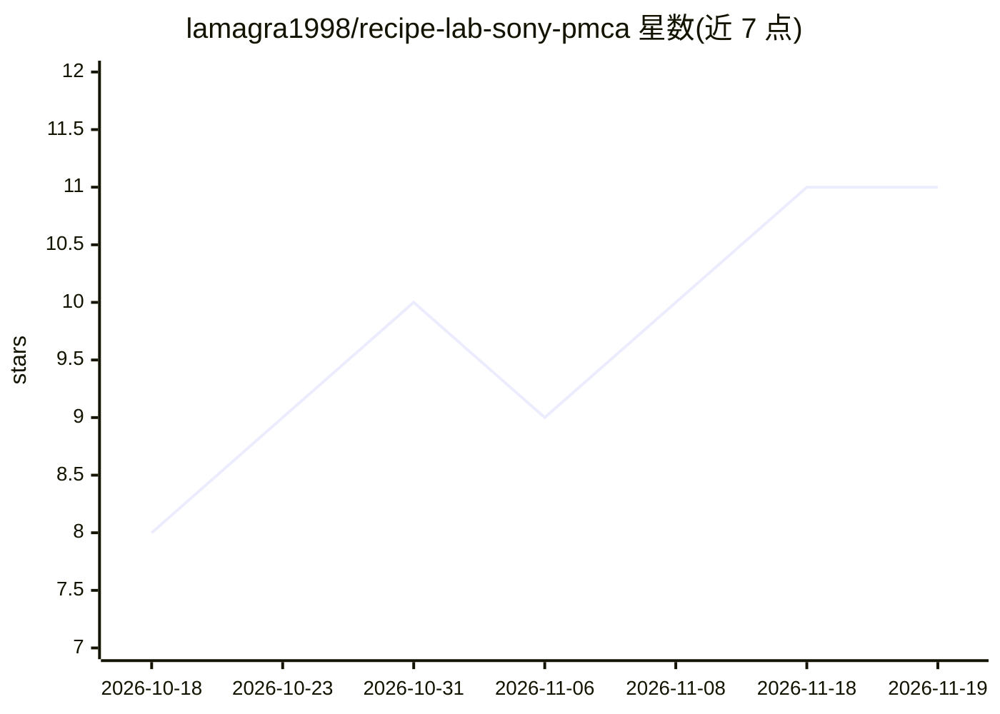

# lamagra1998/recipe-lab-sony-pmca

⭐ 11 · 推送 2026-10-12 · [GitHub](https://github.com/lamagra1998/recipe-lab-sony-pmca) · 个人维护

**给索尼 A6000 相机写入 77 种胶片模拟配方的安卓应用**

免费安卓应用，通过 USB 连接将 77 个针对索尼 A6000 传感器调校的胶片模拟配方直接写入相机内存，无需电脑与驱动。配方按经典胶片、电影感、自然、创意四类组织，覆盖 Kodak Portra、Fuji Velvia、Ilford HP5 等样式；应用要求 Android 6.0 以上，通过 APK 侧载安装，配方与原机设置均可随时删除还原。开发者接受 GitHub Sponsors 赞助。README 未描述任何 AI 相关功能。

## 筛选速览

| 维度 | 判定 | 备注 |
|---|---|---|
| AI 角色 | `ai-knowledge` | 知识聚合/清单类 |
| 许可风险 | `none` | — |
| 部署形态 | `None` |  |
| 模型依赖 | — | README 未给出锁定关系 |
| 硬件要求 | — | 无带数字的原话,不猜 |
| 安装摩擦 | `low` | 无编译、无系统依赖或容器化 |
| 成熟度 | — | 结构信号不足 |

## 能力要点

- 77 个针对 A6000 传感器与色彩科学调校的配方
- USB 连接手机后自动检测相机，一键写入配方
- 四类配方组织：经典胶片/电影感/自然/创意
- 配方可随时删除，不永久更改原机设置

## 适用场景

- 把胶片风格参数直接存进 A6000 拍摄时调用
- 拍摄现场快速切换不同照片风格
- 外出时不想携带笔记本或纸质设置笔记

## 场景标签

 · 领域:摄影/相机工具

## 证据(README 行号)

> L9: Recipe Lab is a free Android app that puts **77 professional film simulation recipes** directly onto your Sony A6000
> L60: - **Android phone** (version 6.0 or newer – that's from 2015, so almost any phone works)
> L61: - **Sony A6000 camera**

## 星数曲线

2026-10-18 8 → 2026-11-19 11（+3）

---
*卡片 v1 · prompt 1.4 · 生成 2026-11-18 · 置信度 low · 依据 README sha `ec5e30fb23a4` · [字段定义](../../DATASET.md)*
