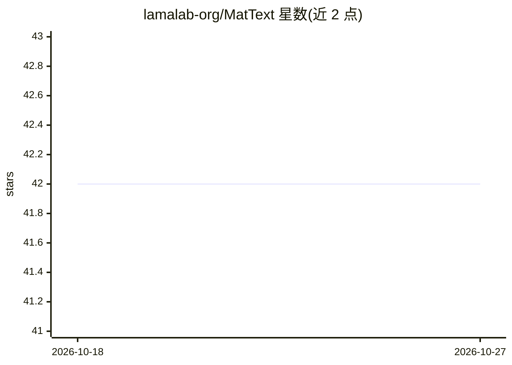

# lamalab-org/MatText

⭐ 42 · Jupyter Notebook · MIT · 推送 2026-08-14 · [GitHub](https://github.com/lamalab-org/MatText) · [官网](https://lamalab-org.github.io/MatText/) · 组织维护

**将晶体结构转为文本并用语言模型建模的材料学框架**

面向材料信息学研究者的 Python 框架：提供晶体结构与文本表示之间的相互转换、结构变换用于敏感性分析、文本分词，以及在晶体文本表示上预训练、微调、测试和分析语言模型的流程。通过 uv/pip 安装，支持 Python 3.10/3.11；使用 Local Env 表示时需另装 OpenBabel。数据集发布在 HuggingFace，预训练与基准测试通过配置命令运行。

## 筛选速览

| 维度 | 判定 | 备注 |
|---|---|---|
| AI 角色 | `ai-ecosystem` | LLM/agent 周边工具 |
| 许可风险 | `permissive` | MIT |
| 部署形态 | `library` | 以包/库形式分发 |
| 模型依赖 | — | README 未给出锁定关系 |
| 硬件要求 | — | 无带数字的原话,不猜 |
| 安装摩擦 | `low` | 无编译、无系统依赖或容器化 |
| 成熟度 | — | 结构信号不足 |

## 能力要点

- 晶体结构与文本表示的双向转换与分词
- 支持语言模型的预训练、微调、测试与分析
- 结构变换用于敏感性分析
- 数据集可从 HuggingFace 加载

## 适用场景

- 把晶体结构转成文本用于语言模型训练
- 在材料数据集上跑预训练与基准测试
- 分析语言模型对材料建模的表现

## 场景标签

`模型训练` `微调` `模型评测` · 领域:评测与运维

## 证据(README 行号)

> L10: MatText is a framework for text-based materials modeling. It supports
> L16: - pre-training, finetuning and testing of language models on text-representations of crystal structures

## 星数曲线

2026-10-18 42 → 2026-10-27 42（+0）

---
*卡片 v1 · prompt 1.4 · 生成 2026-10-25 · 置信度 high · 依据 README sha `b0246a232d46` · [字段定义](../../DATASET.md)*
