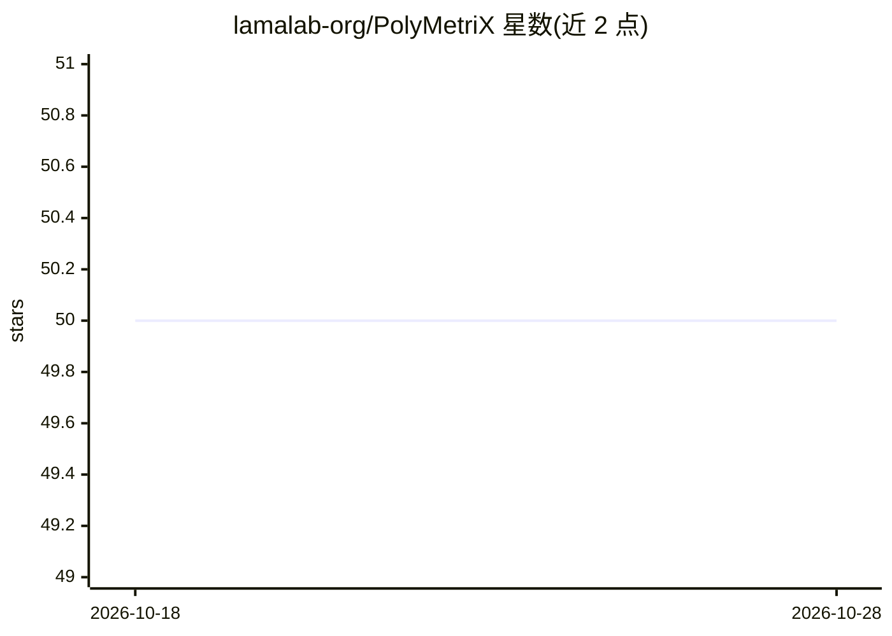

# lamalab-org/PolyMetriX

⭐ 50 · Python · MIT · 推送 2026-07-15 · [GitHub](https://github.com/lamalab-org/PolyMetriX) · [官网](https://lamalab-org.github.io/PolyMetriX/) · 组织维护

**聚合物信息学的机器学习全流程 Python 库**

面向聚合物科学的 Python 库，覆盖机器学习工作流：加载策展数据集（如玻璃化转变温度数据集）、对聚合物/分子/聚合物-有机混合物做特征化（分子量、氢键供受体数、可旋转键等描述符），用于构建结构-性能关系。提供 PyPI 安装（需 Python 3.10+），附论文引用要求，由 lamalab-org 组织维护。

## 筛选速览

| 维度 | 判定 | 备注 |
|---|---|---|
| AI 角色 | `ai-native` | 本体是模型或模型工具 |
| 许可风险 | `permissive` | MIT |
| 部署形态 | `library` | 以包/库形式分发 |
| 模型依赖 | — | README 未给出锁定关系 |
| 硬件要求 | — | 无带数字的原话,不猜 |
| 安装摩擦 | `low` | 无编译、无系统依赖或容器化 |
| 成熟度 | — | 结构信号不足 |

## 能力要点

- 策展玻璃化转变温度数据集加载
- 聚合物/分子多类特征化器（侧链-主链全聚合物特征化等）
- 聚合物-有机混合物的 Comparator 方法
- 物理信息特征化（physics-informed featurization）

## 适用场景

- 我在做聚合物性质预测研究，需要标准数据集与特征工程工具
- 为聚合物-有机混合物体系生成分子描述符
- 构建聚合物结构-性能关系的机器学习流程

## 场景标签

`数据分析` · 领域:效率与自动化

## 证据(README 行号)

> L21: _PolyMetriX_ is a comprehensive Python library that powers the entire machine learning workflow for polymer informa
> L44: dataset = CuratedGlassTempDataset()

## 星数曲线

2026-10-18 50 → 2026-10-28 50（+0）

---
*卡片 v1 · prompt 1.4 · 生成 2026-10-24 · 置信度 high · 依据 README sha `0077091ccc9f` · [字段定义](../../DATASET.md)*
