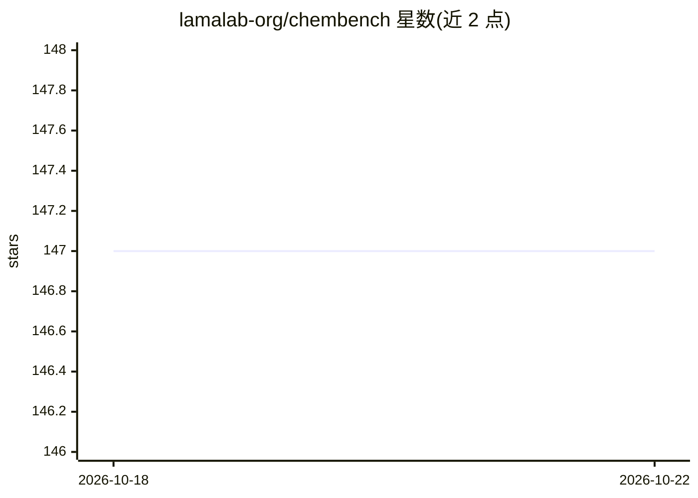

# lamalab-org/chembench

⭐ 147 · Python · MIT · 推送 2026-01-26 · [GitHub](https://github.com/lamalab-org/chembench) · [官网](https://chembench.lamalab.org/) · 组织维护

**评测 LLM 化学能力的 Python 基准测试套件**

用于构建和运行大语言模型与多模态模型（如视觉语言模型）基准测试的 Python 包。最初为化学领域的 LLM 性能评测套件开发，后扩展支持多模态模型。设计上模块化、可扩展，允许用户添加新数据集、模型和评测指标；运行评测后结果按主题自动保存为报告。要求 Python 3.10 或 newer，通过 pip 安装，配有文档、测试与 Hugging Face 托管的排行榜。

## 筛选速览

| 维度 | 判定 | 备注 |
|---|---|---|
| AI 角色 | `ai-ecosystem` | LLM/agent 周边工具 |
| 许可风险 | `permissive` | MIT |
| 部署形态 | `library` | 以包/库形式分发 |
| 模型依赖 | — | README 未给出锁定关系 |
| 硬件要求 | — | 无带数字的原话,不猜 |
| 安装摩擦 | `low` | 无编译、无系统依赖或容器化 |
| 成熟度 | — | 结构信号不足 |

## 能力要点

- 构建和运行 LLM 与多模态模型的基准测试
- 模块化设计，可添加新数据集、模型与评测指标
- 评测结果自动保存为主题特定报告
- 配有 Hugging Face 排行榜与两篇论文（化学、多模态）

## 适用场景

- 评测大语言模型在化学领域的表现
- 评测视觉语言模型在化学与材料任务上的能力
- 扩展自定义数据集与评测指标构建新基准

## 场景标签

`模型评测` · 领域:评测与运维

## 证据(README 行号)

> L27: *ChemBench* is a Python package for building and running benchmarks of large language models and multimodal models 
> L29: *ChemBench* was developed as a comprehensive benchmarking suite for the performance of LLMs in chemistry (see our p

## 星数曲线

2026-10-18 147 → 2026-10-22 147（+0）

---
*卡片 v1 · prompt 1.4 · 生成 2026-10-22 · 置信度 high · 依据 README sha `d3c8e89068e7` · [字段定义](../../DATASET.md)*
