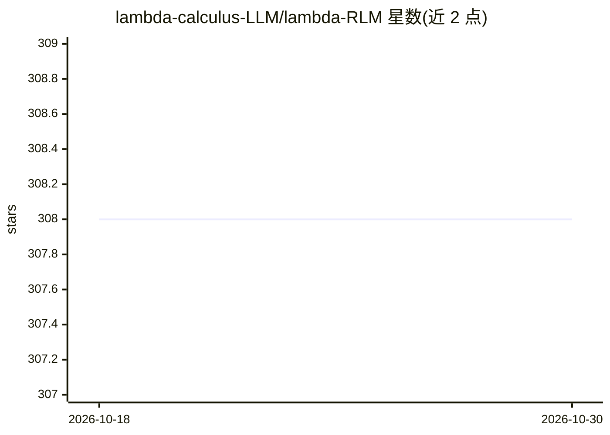

# lambda-calculus-LLM/lambda-RLM

⭐ 308 · Python · MIT · 推送 2026-04-24 · [GitHub](https://github.com/lambda-calculus-LLM/lambda-RLM) · 组织维护

**面向 LLM 长上下文推理的 λ-演算类型化递归框架**

λ-RLM 是一个长上下文推理框架：以基于 λ-演算的类型化函数式运行时取代自由形式的递归代码生成，执行预验证组合子库（SPLIT/MAP/FILTER/REDUCE 等）的确定性递归分解，仅在有界叶子子问题上调用神经推理，符号化组合中间结果。声称提供终止性、闭式成本界等形式保证。支持 API 兼容的多模型后端（NVIDIA NIM、Together AI），内置 sniah、oolong、browsecomp、codeqa 数据集的基准评测入口，用于与标准 RLM 对比。以 Python 源码（pip install -e）方式安装，需 Python 3.11+ 与 API key。

## 筛选速览

| 维度 | 判定 | 备注 |
|---|---|---|
| AI 角色 | `ai-ecosystem` | LLM/agent 周边工具 |
| 许可风险 | `permissive` | MIT |
| 部署形态 | `library` | 以包/库形式分发 |
| 模型依赖 | locked-api |  |
| 硬件要求 | — | 无带数字的原话,不猜 |
| 安装摩擦 | `low` | 无编译、无系统依赖或容器化 |
| 成熟度 | — | 结构信号不足 |

## 能力要点

- 类型化函数式运行时执行预验证组合子（SPLIT/MAP/FILTER/REDUCE/CONCAT/CROSS）
- 神经推理限定在有界叶子子问题，结果符号化组合
- 声称终止性、闭式成本界、递归深度控制精度等形式保证
- 内置基准入口支持 4 种长上下文数据集与 Normal RLM 对比

## 适用场景

- 在超长输入任务上以受限模型调用做递归推理
- 研究者对比 λ-RLM 与标准 RLM 的精度与延迟
- 需要可预测计算成本与可验证控制流的长文档问答实验

## 场景标签

`文档问答` · 领域:知识与检索

## 证据(README 行号)

> L31: λ-RLM is a framework for long-context reasoning that replaces **free-form recursive code generation** with a **type
> L32: Instead of letting the model write arbitrary recursive control logic during execution, λ-RLM executes a compact lib
> L162: The benchmark entry point is used to run the supported datasets under the same setup and compare behavior, latency

## 星数曲线

2026-10-18 308 → 2026-10-30 308（+0）

---
*卡片 v1 · prompt 1.4 · 生成 2026-10-22 · 置信度 high · 依据 README sha `4042850d47d3` · [字段定义](../../DATASET.md)*
