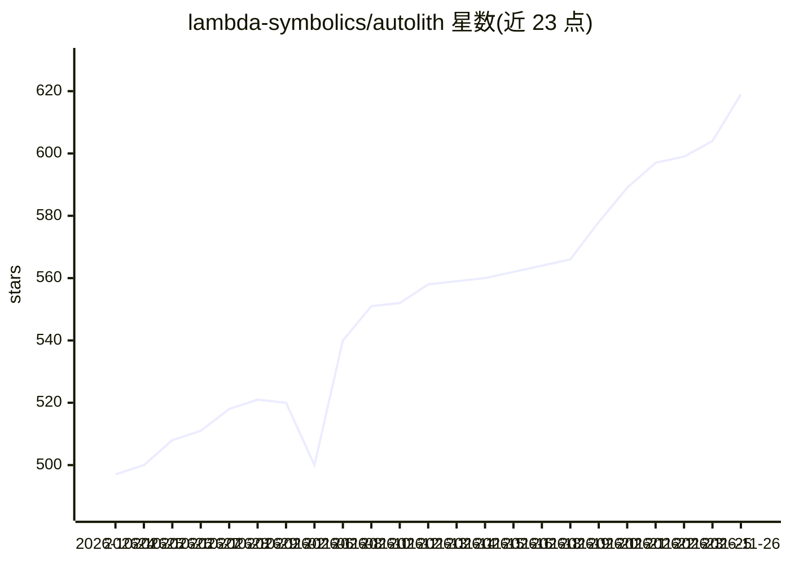

# lambda-symbolics/autolith

⭐ 619 · Common Lisp · ISC · 推送 2026-11-25 · [GitHub](https://github.com/lambda-symbolics/autolith) · [官网](https://autolith.rocks) · 组织维护

**可自修改的 Common Lisp 终端 AI agent**

运行在活体 Common Lisp 镜像中的通用 agent，用户在 REPL 中直接获得模型输出并与之协作。关键机制包括：带检查点与恢复的活体自修改、持久记忆与符号推理以减少不必要的 LLM 调用、用递归语言模型（RLM）处理超上下文窗口的大规模数据、通过 World of Channels 协调多 agent，以及经工具/技能/MCP 扩展。限制：类 Unix 与 Windows 平台运行，面向长程任务，无需 Lisp 知识。

## 筛选速览

| 维度 | 判定 | 备注 |
|---|---|---|
| AI 角色 | `ai-native` | 本体是模型或模型工具 |
| 许可风险 | `permissive` | ISC |
| 部署形态 | `None` |  |
| 模型依赖 | locked-api |  |
| 硬件要求 | — | 无带数字的原话,不猜 |
| 安装摩擦 | `low` | 无编译、无系统依赖或容器化 |
| 成熟度 | — | 结构信号不足 |

## 能力要点

- 活体自修改自身代码与运行状态，带检查点恢复
- 持久记忆与符号推理减少不必要的 LLM 调用
- RLM 处理大规模数据而不撑爆上下文窗口
- 多 agent 通过 World of Channels 协调，支持不同模型与角色

## 适用场景

- 在终端中用自然语言与 agent 协作完成编码等长程任务
- 让多个不同模型的 agent 在频道中协同分工
- 处理超出上下文窗口规模的大量信息

## 场景标签

`编码 Agent` `多智能体` · 领域:Agent 开发

## 证据(README 行号)

> L1: #+SUBTITLE: The self-modifying Common Lisp neurosymbolic agent
> L13: Autolith (or AL), is an agent plopped into a live [[https://en.wikipedia.org/wiki/Common_Lisp][Common Lisp]] image:
> L25: - *Extensibility:* Extend its capabilities through tools, skills, [[https://modelcontextprotocol.io/][MCP]] servers

## 星数曲线

2026-10-24 497 → 2026-11-26 619（+122）

---
*卡片 v1 · prompt 1.4 · 生成 2026-11-25 · 置信度 high · 依据 README sha `65869d796b0c` · [字段定义](../../DATASET.md)*
