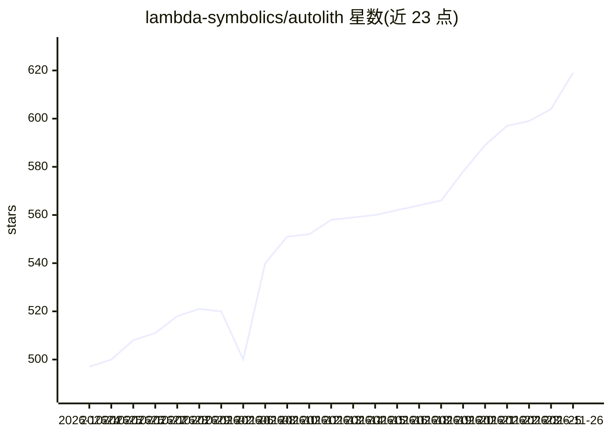

# lambda-symbolics/autolith

⭐ 619 · Common Lisp · ISC · 推送 2026-11-25 · [GitHub](https://github.com/lambda-symbolics/autolith) · [官网](https://autolith.rocks) · 组织维护

**自修改的 Common Lisp 终端 AI agent，面向长时程任务**

Autolith 是一个驻留在实时 Common Lisp 镜像中的通用 agent：支持对自身代码与运行状态的检查/修改（带检查点与失败恢复）、持久记忆与符号推理以减少 LLM 调用、基于递归语言模型（RLM）的大规模数据处理、多 agent 通过 World of Channels 协作、以及面向长时程目标的自主执行与计划。输入是带语法糖的 REPL，Lisp 求值、工具调用与命令无区别。提供多平台独立二进制、Nix 包、安装脚本与源码构建路径，通过 auth 命令配置十余家模型提供方。

## 筛选速览

| 维度 | 判定 | 备注 |
|---|---|---|
| AI 角色 | `ai-native` | 本体是模型或模型工具 |
| 许可风险 | `permissive` | ISC |
| 部署形态 | `None` |  |
| 模型依赖 | locked-api |  |
| 硬件要求 | — | 无带数字的原话,不猜 |
| 安装摩擦 | `low` | 无编译、无系统依赖或容器化 |
| 成熟度 | — | 结构信号不足 |

## 能力要点

- 实时自修改自身代码与运行状态，带检查点与恢复机制
- 符号推理与持久记忆减少不必要的 LLM 调用
- 多 agent 通过 World of Channels 以不同模型与角色协作
- 通过 tools/skills/MCP 服务器扩展能力

## 适用场景

- 在终端 REPL 中运行可自主推进的长时程任务
- 需要处理大规模数据且不撑爆上下文窗口的场景
- 多个模型/角色组成 agent 层级协同工作

## 场景标签

`多智能体` `Agent 框架` · 领域:Agent 开发

## 证据(README 行号)

> L13: Autolith (or AL), is an agent plopped into a live [[https://en.wikipedia.org/wiki/Common_Lisp][Common Lisp]] image:
> L22:  of persistent agents through a /World of Channels/, with different models, reasoning efforts, and roles.
> L25: - *Extensibility:* Extend its capabilities through tools, skills, [[https://modelcontextprotocol.io/][MCP]] servers

## 星数曲线

2026-10-24 497 → 2026-11-26 619（+122）

---
*卡片 v1 · prompt 1.4 · 生成 2026-11-26 · 置信度 high · 依据 README sha `8267dc888979` · [字段定义](../../DATASET.md)*
