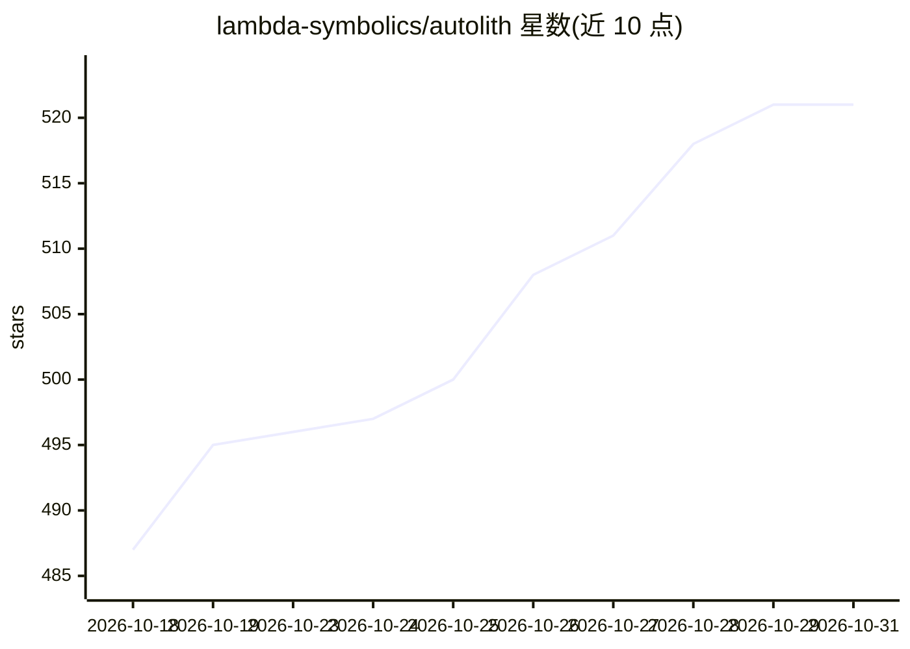

# lambda-symbolics/autolith

⭐ 521 · Common Lisp · ISC · 推送 2026-10-30 · [GitHub](https://github.com/lambda-symbolics/autolith) · [官网](https://www.lambda-symbolics.com/autolith) · 组织维护

**可自我修改的 Common Lisp 终端 AI 代理**

运行在活动 Common Lisp 镜像内的终端代理：可观察、自省并修改自身代码与活动状态，以适应用户偏好或任务需要；通过创建镜像世代支持回滚，故障时可重载恢复镜像并诊断修复。遵循 XDG 标准，提供文档（Guide/Architecture/Skills/MCP/RLM）。支持 Linux/macOS/各 BSD/Windows 平台，提供独立二进制发布、curl 安装脚本、Nix 包与源码构建；通过 autolith auth 命令以 web 流程或 API key 认证十余家模型提供方。

## 筛选速览

| 维度 | 判定 | 备注 |
|---|---|---|
| AI 角色 | `ai-native` | 本体是模型或模型工具 |
| 许可风险 | `permissive` | ISC |
| 部署形态 | `None` |  |
| 模型依赖 | locked-api |  |
| 硬件要求 | — | 无带数字的原话,不猜 |
| 安装摩擦 | `low` | 无编译、无系统依赖或容器化 |
| 成熟度 | — | 结构信号不足 |

## 能力要点

- 在活动 Lisp 镜像内自省与自我修改，支持世代回滚与恢复镜像
- 支持 Linux/macOS/FreeBSD/NetBSD/OpenBSD/Windows 多平台
- 独立二进制、curl 安装脚本、Nix 包多种分发方式
- 内置命令认证多家模型提供方（chatgpt/copilot/gemini/anthropic 等）

## 适用场景

- 在终端中通过对话驱动 AI 代理完成任务
- 需要代理适应个人偏好或定制自身行为的场景
- 在 Lisp 环境中结合 MCP 与技能进行开发工作

## 场景标签

`编码 Agent` · 领域:编码与开发

## 证据(README 行号)

> L13: Autolith, or AL, is a terminal agent inside a live Common Lisp image. It can
> L14: observe, self-modify, discover, introspect its own code, its live state and what

## 星数曲线

2026-10-18 487 → 2026-10-31 521（+34）

---
*卡片 v1 · prompt 1.4 · 生成 2026-10-22 · 置信度 high · 依据 README sha `c8bf363765b0` · [字段定义](../../DATASET.md)*
