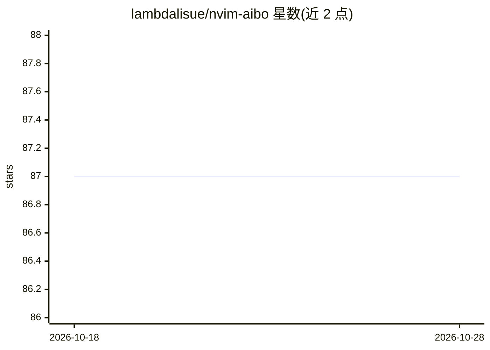

# lambdalisue/nvim-aibo

⭐ 87 · Lua · MIT · 推送 2026-07-07 · [GitHub](https://github.com/lambdalisue/nvim-aibo) · 个人维护

**Neovim 插件：在编辑器内集成并编排 AI CLI 助手**

纯 Lua 实现的 Neovim 插件，在浮动窗口中运行交互式 CLI 工具并提供透明提示浮层。针对 AI 助手内置支持：Claude（模式切换、verbose、todo 管理）、Codex（transcript 视图、导航）、Ollama（模型补全、thinking 模式），并兼容 Gemini 等 CLI 工具；也可运行编程 REPL 与数据库客户端等任意交互式 CLI。提供命令补全、:AiboSend 缓冲区内容发送、丰富的键位映射与自定义配置。需 Neovim 0.10.0+ 与外部 CLI 工具，README 声明处于 beta 阶段，API 可能变动。

## 筛选速览

| 维度 | 判定 | 备注 |
|---|---|---|
| AI 角色 | `ai-ecosystem` | LLM/agent 周边工具 |
| 许可风险 | `permissive` | MIT |
| 部署形态 | `None` |  |
| 模型依赖 | local-ok | 支持本地模型 |
| 硬件要求 | — | 无带数字的原话,不猜 |
| 安装摩擦 | `low` | 无编译、无系统依赖或容器化 |
| 成熟度 | `idea` | |

## 能力要点

- 内置 Claude/Codex/Ollama 专门适配（模式切换、transcript、模型补全）
- 支持任意交互式 CLI 工具（REPL、psql/mysql 等）
- 工具名/子命令/参数/模型名的智能 Tab 补全
- :AiboSend 直接将缓冲区内容发送到 CLI 控制台

## 适用场景

- 在 Neovim 中与 Claude/Codex/Ollama CLI 对话编码
- 在编辑器内运行 Python/Node REPL 或数据库客户端
- 把选中的代码或错误信息直接发给 AI 助手

## 场景标签

`AI 助手` · 领域:对话与助手

## 证据(README 行号)

> L20: Aibo (from Japanese "companion") is designed as your AI companion in Neovim, providing seamless integration with AI
> L23: - **Optimized for AI assistants** with built-in support:

## 星数曲线

2026-10-18 87 → 2026-10-28 87（+0）

---
*卡片 v1 · prompt 1.4 · 生成 2026-10-23 · 置信度 high · 依据 README sha `ba8a55b4e41f` · [字段定义](../../DATASET.md)*
