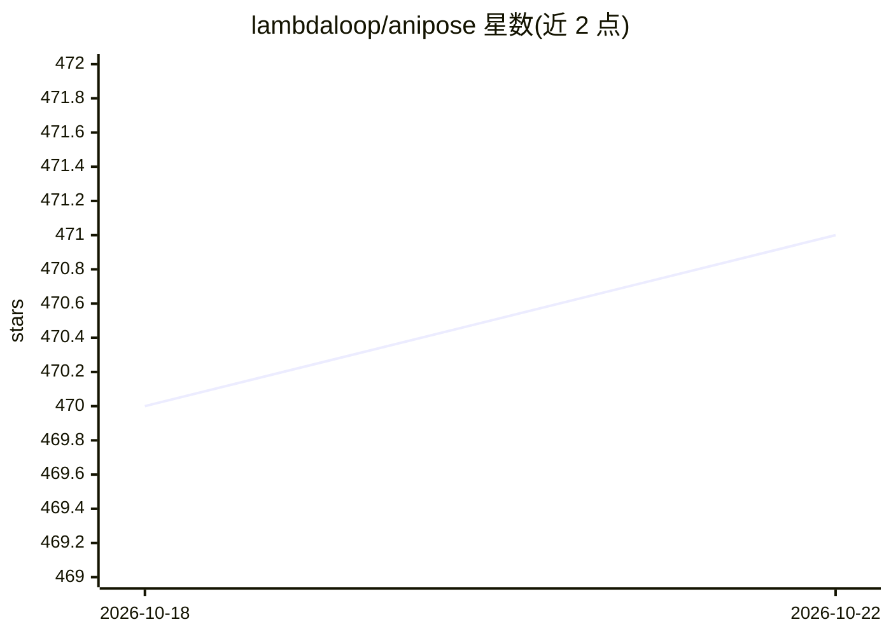

# lambdaloop/anipose

⭐ 471 · JavaScript · BSD-2-Clause · 推送 2026-06-02 · [GitHub](https://github.com/lambdaloop/anipose) · [官网](http://anipose.org) · 个人维护

**多相机动物行为的无标记 3D 姿态估计工具箱**

开源工具箱，用于从多个相机视角对动物行为做无标记 3D 姿态估计。机制：调用 DeepLabCut 在各相机画面中跟踪 2D 关键点，再跨相机视角三角化重建 3D 姿态；支持相机标定。以 Python 包形式发布于 PyPI，附有论文、在线文档（anipose.org）与演示视频（果蝇、人手）。面向动物行为学研究的科研用户。

## 筛选速览

| 维度 | 判定 | 备注 |
|---|---|---|
| AI 角色 | `ai-native` | 本体是模型或模型工具 |
| 许可风险 | `permissive` | BSD-2-Clause |
| 部署形态 | `library` | 以包/库形式分发 |
| 模型依赖 | — | README 未给出锁定关系 |
| 硬件要求 | — | 无带数字的原话,不猜 |
| 安装摩擦 | `low` | 无编译、无系统依赖或容器化 |
| 成熟度 | — | 结构信号不足 |

## 能力要点

- 基于 DeepLabCut 的 2D 关键点跟踪
- 跨多相机视角三角化重建 3D 姿态
- 提供相机标定流程与配套论文、文档、演示视频

## 适用场景

- 实验室多相机录制下重建动物 3D 行为轨迹
- 需要无标记方式追踪动物关节姿态的研究
- 果蝇等模式动物的行为学定量分析

## 场景标签

`科研工具` · 领域:学习与行业

## 证据(README 行号)

> L5: Anipose is an open-source toolkit for robust, markerless 3D pose estimation of animal behavior from multiple camera 
> L17: Videos of flies by Evyn Dickinson (slowed 5x), Tuthill Lab

## 星数曲线

2026-10-18 470 → 2026-10-22 471（+1）

---
*卡片 v1 · prompt 1.4 · 生成 2026-10-21 · 置信度 high · 依据 README sha `a4db016cc377` · [字段定义](../../DATASET.md)*
