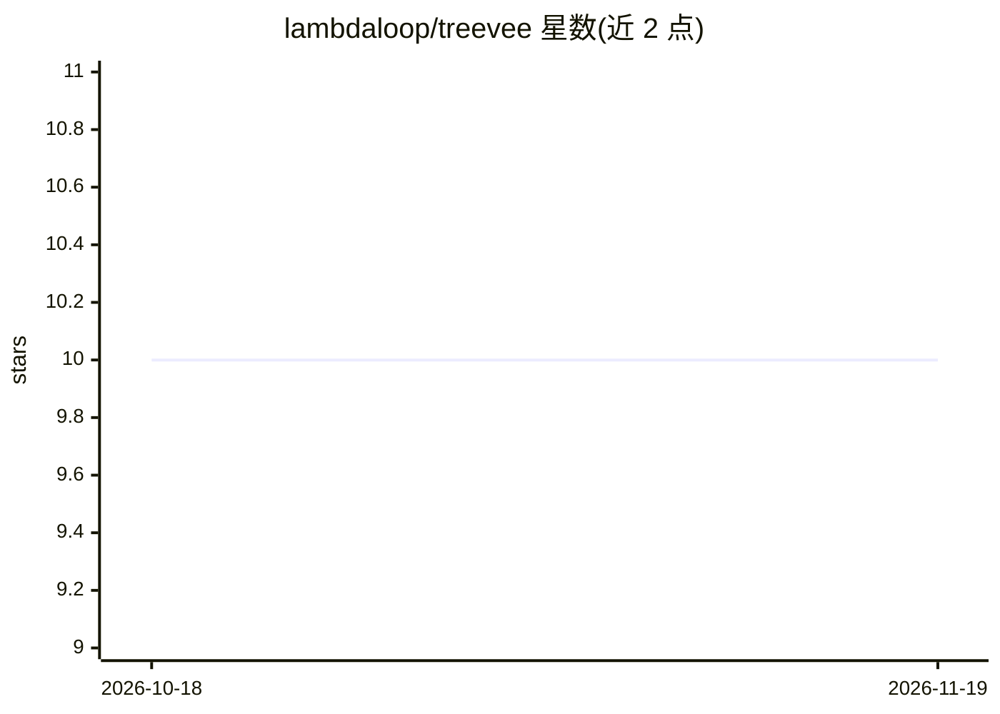

# lambdaloop/treevee

⭐ 10 · Python · MIT · 推送 2026-05-29 · [GitHub](https://github.com/lambdaloop/treevee) · 个人维护

**用 LLM 加树搜索自动优化带评分函数的任务**

基于 MLEvolve 思路实现的项目：给定评分函数、任务描述与待修改代码，通过树搜索迭代生成候选解——planner LLM 提出改进/调试/融合建议，editor LLM 实现修改，eval 命令打分后循环。默认以 Claude Code 作为 harness，planner 与 editor 可分别配置模型、provider 与 API key；提供 init/run/viz 等命令与网页可视化。执行由 bubblewrap/zerobox 沙箱限制。作者自述项目较新、维护节奏未定。

## 筛选速览

| 维度 | 判定 | 备注 |
|---|---|---|
| AI 角色 | `ai-native` | 本体是模型或模型工具 |
| 许可风险 | `permissive` | MIT |
| 部署形态 | `None` |  |
| 模型依赖 | locked-api |  |
| 硬件要求 | — | 无带数字的原话,不猜 |
| 安装摩擦 | `low` | 无编译、无系统依赖或容器化 |
| 成熟度 | `idea` | |

## 能力要点

- planner/editor 分离：planner 只有读取与 web 搜索权限，editor 仅能编辑 experiment/ 子文件夹
- 树搜索 + 评分函数驱动的迭代优化，支持从快照恢复（best/root/指定节点）
- 支持 anthropic、deepseek、openrouter 及自定义 base URL（可接本地模型）
- 提供 web 可视化服务器检视搜索树与分数变化

## 适用场景

- 自动优化有明确评分指标的代码或算法
- 以自然语言描述任务，让 LLM 迭代改进解决方案
- 搜索空间探索后回滚到最优或指定节点的代码

## 场景标签

`编码 Agent` · 领域:编码与开发

## 证据(README 行号)

> L9: Given a scoring function, a task description, and code to modify, treevee will conduct a tree search over possible s
> L85: Configure your LLM providers in `~/.config/treevee/treevee.toml`. This file allows you to set different models, pro
> L96: - `provider`: The API provider. Supported values include `anthropic`, `deepseek`, `openrouter`, or a custom base UR

## 星数曲线

2026-10-18 10 → 2026-11-19 10（+0）

---
*卡片 v1 · prompt 1.4 · 生成 2026-11-19 · 置信度 high · 依据 README sha `3c100f5a8db8` · [字段定义](../../DATASET.md)*
