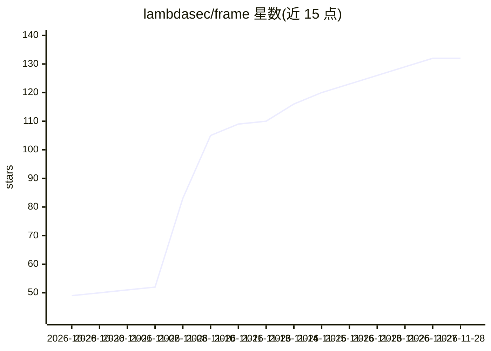

# lambdasec/frame

⭐ 132 · Python · Apache-2.0 · 推送 2026-11-27 · [GitHub](https://github.com/lambdasec/frame) · [官网](https://lambdasec.github.io/) · 组织维护

**面向现代应用的开源 SAST：代码、依赖、密钥、基础设施与 AI 一体扫描**

通过数据流追踪与求解器证明（基于 Z3 的分离逻辑引擎）发现漏洞，而非模式匹配，覆盖代码、依赖、密钥、IaC 与 AI 调用五类扫描目标，支持五种语言、121 个框架包与 11 种生态 lockfile。完全离线运行， proven 发现可作为可运行测试并验证修复是否移除漏洞；可选 LLM 层使用任意 OpenAI 兼容模型增强召回与分诊。通过 pip 安装，输出 SARIF/JSON 等报告，提供 GitHub Action、pre-commit 钩子与 MCP server。

## 筛选速览

| 维度 | 判定 | 备注 |
|---|---|---|
| AI 角色 | `ai-ecosystem` | LLM/agent 周边工具 |
| 许可风险 | `permissive` | Apache-2.0 |
| 部署形态 | `self-host` | docker 或自建部署 |
| 模型依赖 | — | README 未给出锁定关系 |
| 硬件要求 | — | 无带数字的原话,不猜 |
| 安装摩擦 | `low` | 无编译、无系统依赖或容器化 |
| 成熟度 | — | 结构信号不足 |

## 能力要点

- 基于 Z3 求解器证明发现可达性，修复可被证明有效
- 覆盖代码、依赖可达性、密钥（含 git 历史）、IaC、容器与 AI 应用扫描
- 可选 LLM 层兼容任意 OpenAI 兼容端点，含本地设备模型
- 提供 MCP server 供 Claude Code、Codex、Cursor 等编码 agent 调用 frame query

## 适用场景

- CI 中仅对已证明的发现阻断构建（--fail-on-evidence）
- 扫描 AI 应用中的 prompt 注入与 MCP 工具元数据攻击
- 离线环境下做依赖可达性与 OSV 匹配分析
- 用 LLM 辅助检测越权访问与业务逻辑缺陷，再由引擎验证

## 场景标签

`网络安全` · 领域:学习与行业

## 证据(README 行号)

> L11: Frame finds vulnerabilities by **following attacker data through your code**, across functions, files and layers, a
> L33: - **Built for the AI-coding era**: scan only what changed, baseline what you accept, `verify` that a fix removed th

## 星数曲线

2026-10-28 49 → 2026-11-28 132（+83）

---
*卡片 v1 · prompt 1.4 · 生成 2026-11-28 · 置信度 mid · 依据 README sha `227b08479c45` · [字段定义](../../DATASET.md)*
