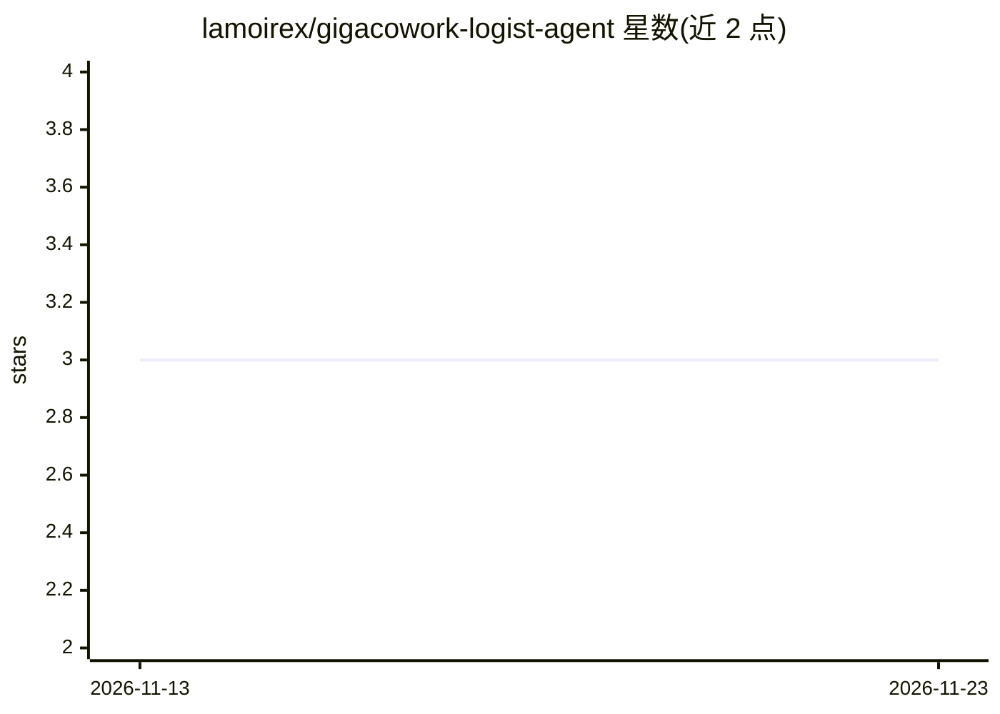

# lamoirex/gigacowork-logist-agent

⭐ 3 · Python · 推送 2026-11-19 · [GitHub](https://github.com/lamoirex/gigacowork-logist-agent) · 个人维护

**GigaCowork 上按 1С 导出为物流员分配订单的 AI 技能**

为 GigaCowork 平台开发的 agent 技能：读取三份 Excel 导出（1С 的 ФУЛ、Cloud 台账、1С 员工表），识别新打包清单、剔除重复发货，按规则分组并指派物流员，按 Cloud 台账 12 列格式生成结果工作簿及给每位物流员的信件草稿。决策由确定性脚本执行，LLM（GigaChat）负责调用脚本并逐字复述结果，附 justify 日志与每个分配的理由；提供测试、fuzz 测试、基准、Docker 与 CI/CD。

## 筛选速览

| 维度 | 判定 | 备注 |
|---|---|---|
| AI 角色 | `ai-native` | 本体是模型或模型工具 |
| 许可风险 | `none` | — |
| 部署形态 | `self-host` | docker 或自建部署 |
| 模型依赖 | — | README 未给出锁定关系 |
| 硬件要求 | — | 无带数字的原话,不猜 |
| 安装摩擦 | `low` | 无编译、无系统依赖或容器化 |
| 成熟度 | — | 结构信号不足 |

## 能力要点

- 确定性脚本决策 + 模型复述，结果可复现（三次运行内容哈希一致）
- 按表头同义词识别文件角色，fuzz 测试覆盖 50 种格式变体
- 输出包含决策日志、待处理清单与给物流员的信件草稿
- Excel 注入防护与原子写入；Docker 支持企业镜像源替换

## 适用场景

- 把 1С 导出的 ФУЛ 批量分配给物流团队
- 生成符合 Cloud 台账格式的登记行并剔除重复
- 为新供应商批量到货做公平负载的首次分派

## 场景标签

`工作流自动化` · 领域:效率与自动化

## 证据(README 行号)

> L8: Тестовое задание «Фабрики решений»: AI-агент для GigaCowork, который по трём выгрузкам Excel
> L12: > **Решения принимает детерминированный скрипт, модель только запускает его и пересказывает результат.**
> L42: 1. Загрузить навык `logist-distribution.zip` и системный промпт `system_prompt.txt`

## 星数曲线

2026-11-13 3 → 2026-11-23 3（+0）

---
*卡片 v1 · prompt 1.4 · 生成 2026-11-21 · 置信度 high · 依据 README sha `2fe042c99262` · [字段定义](../../DATASET.md)*
