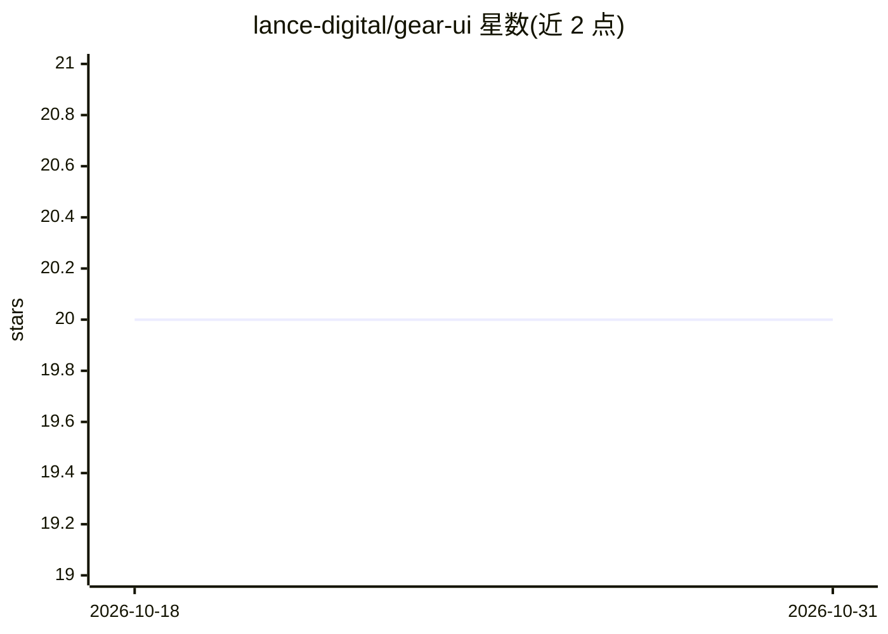

# lance-digital/gear-ui

⭐ 20 · TypeScript · Apache-2.0 · 推送 2026-09-07 · [GitHub](https://github.com/lance-digital/gear-ui) · 个人维护

**从要件文生成画面UI定义书与HTML模型的开源工具**

基于 Next.js 的 Web 应用，通过两段 LLM 流水线从自由格式要件文生成 1-8 个画面的 UI 定义书 JSON，再生成使用 Tailwind 与设计令牌约束的 HTML 模型，可在沙箱 iframe 中预览。LLM 后端可在 Claude（Anthropic）与 OpenAI/OpenAI 兼容端点（OpenRouter、Together、Groq、Ollama 等）之间用环境变量切换；采用 BYOK 方式在 UI 中直接设置 API key。设计规则按项目保存，主题通过替换 tokens.css 即时切换。面向需要从需求快速产出 UI 规格与原型原型的开发者与设计师。

## 筛选速览

| 维度 | 判定 | 备注 |
|---|---|---|
| AI 角色 | `ai-native` | 本体是模型或模型工具 |
| 许可风险 | `permissive` | Apache-2.0 |
| 部署形态 | `library` | 以包/库形式分发 |
| 模型依赖 | local-ok | 支持本地模型 |
| 硬件要求 | — | 无带数字的原话,不猜 |
| 安装摩擦 | `low` | 无编译、无系统依赖或容器化 |
| 成熟度 | — | 结构信号不足 |

## 能力要点

- 两段流水线：要件文→画面UI定义书JSON→HTML模型
- 多 LLM 提供商切换（Claude/OpenAI/OpenAI兼容，含 Ollama 等）
- 设计令牌护栏：禁止生色码，仅允许 var(--color-primary) 语义变量，换 tokens.css 即整体换肤
- BYOK：UI 直接设置 API key，无需编辑 .env

## 适用场景

- 把需求文档转成画面 UI 定义书，保持跨画面字段与组件一致
- 快速生成可预览的 HTML 原型用于评审
- 按项目保存设计规则后批量再生成模型

## 场景标签

`代码生成` · 领域:编码与开发

## 证据(README 行号)

> L9: > AIで **画面UI定義書** と **HTMLモック** を2段パイプラインで生成する OSS ツール。
> L14: AIで **画面UI定義書** と **HTMLモック** を2段パイプラインで生成する OSS ツールです。
> L153: An OSS tool that generates **screen-UI specifications** and **HTML mocks** with a two-stage LLM pipeline.

## 星数曲线

2026-10-18 20 → 2026-10-31 20（+0）

---
*卡片 v1 · prompt 1.4 · 生成 2026-10-28 · 置信度 high · 依据 README sha `449e42501958` · [字段定义](../../DATASET.md)*
