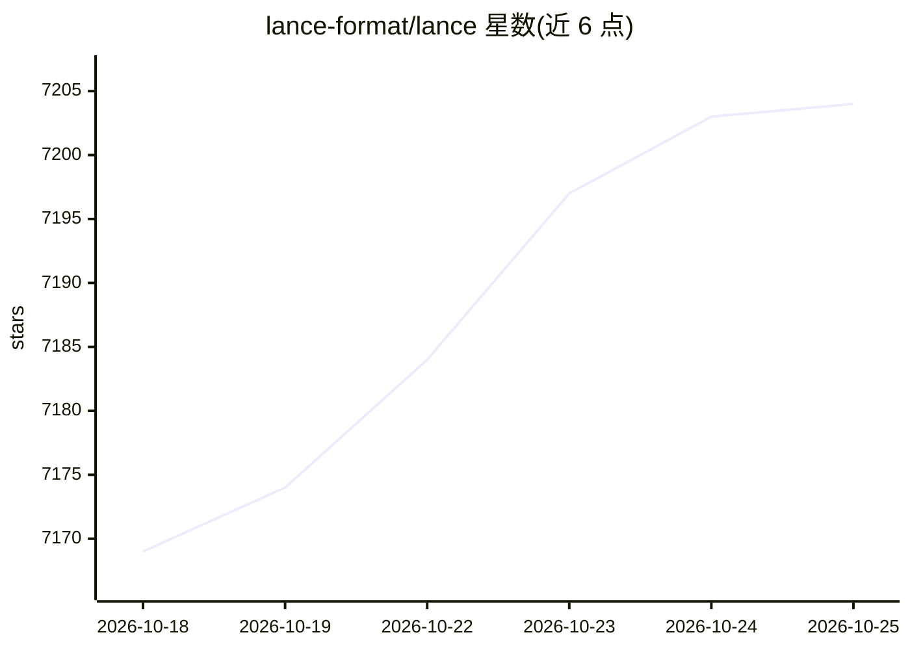

# lance-format/lance

⭐ 7,204 · Rust · Apache-2.0 · 推送 2026-10-24 · [GitHub](https://github.com/lance-format/lance) · [官网](https://lance.org) · 组织维护

**面向多模态 AI 的开放湖仓数据格式，支持向量检索与版本管理**

Lance 提供文件格式、表格式与 catalog 规范，可在对象存储之上构建面向 AI 工作流的湖仓：同一数据集上支持向量相似度检索、BM25 全文本检索与 SQL 分析，原生存储图像、视频、音频、文本与嵌入；提供 ACID 事务的自动版本化、时间旅行与列级数据演化，无需全表重写。兼容 Pandas、DuckDB、Polars、PyArrow、Spark、Ray 等生态。README 声明随机访问较 Parquet/Iceberg 快 100 倍（附 SIFT 与 Oxford Pet 基准）。核心为 Rust 实现，提供 Python/Java 绑定。

## 筛选速览

| 维度 | 判定 | 备注 |
|---|---|---|
| AI 角色 | `ai-ecosystem` | LLM/agent 周边工具 |
| 许可风险 | `permissive` | Apache-2.0 |
| 部署形态 | `library` | 以包/库形式分发 |
| 模型依赖 | — | README 未给出锁定关系 |
| 硬件要求 | — | 无带数字的原话,不猜 |
| 安装摩擦 | `low` | 无编译、无系统依赖或容器化 |
| 成熟度 | — | 结构信号不足 |

## 能力要点

- 同一数据集上的混合检索：向量 + BM25 全文 + SQL 分析
- 原生多模态数据存储（图像/视频/音频/文本/嵌入，blob 编码与懒加载）
- 零拷贝版本化：ACID 事务、时间旅行、tags 与 branches
- 两行代码从 DataFrame/Parquet 转换，兼容 Arrow/Pandas/DuckDB/Polars/Spark/Ray 生态

## 适用场景

- 为搜索与特征存储构建混合检索（向量+全文+SQL）
- 大规模 ML 训练的高性能 IO 与随机访问
- 统一存储与管理含嵌入的多模态数据集
- ML 特征工程中增量加列而不重写全表

## 场景标签

`向量数据库` `MLOps` · 领域:知识与检索

## 证据(README 行号)

> L19: Lance is an open lakehouse format for multimodal AI. It contains a file format, table format, and catalog spec that
> L27: * **Expressive hybrid search:** Combine vector similarity search, full-text search (BM25), and SQL analytics on the
> L185: While existing formats (Parquet, Iceberg, Delta Lake) excel at SQL analytics, they require additional specialized 

## 星数曲线

2026-10-18 7,169 → 2026-10-25 7,204（+35）

---
*卡片 v1 · prompt 1.4 · 生成 2026-10-20 · 置信度 high · 依据 README sha `32b50191b752` · [字段定义](../../DATASET.md)*
