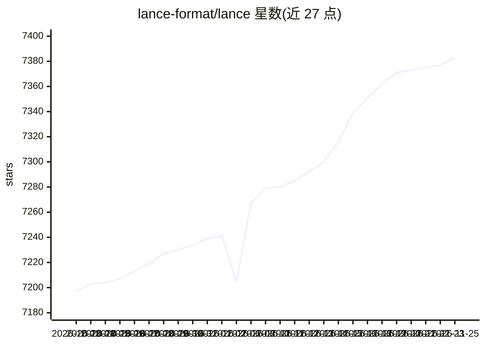

# lance-format/lance

⭐ 7,383 · Rust · Apache-2.0 · 推送 2026-11-24 · [GitHub](https://github.com/lance-format/lance) · [官网](https://lance.org) · 组织维护

**面向多模态 AI 的开放湖仓数据格式，支持向量检索与版本管理**

Lance 是一个开放湖仓格式，包含文件格式、表格式与目录规范，用于在对象存储上构建支撑 AI 工作流的湖仓。核心机制：向量相似检索与全文检索（BM25）、SQL 分析混合查询、加速随机访问、blob 编码存储图像/视频/音频/文本/嵌入、ACID 版本与分支、免重写的列演进。提供 pip 安装的 Python 包，兼容 Pandas、DuckDB、Polars、PyArrow、Ray、Spark 等，核心实现为 Rust 并带 Python/Java 绑定。README 提示格式仍在活跃开发，生产数据应使用稳定 storage 版本。

## 筛选速览

| 维度 | 判定 | 备注 |
|---|---|---|
| AI 角色 | `ai-ecosystem` | LLM/agent 周边工具 |
| 许可风险 | `permissive` | Apache-2.0 |
| 部署形态 | `library` | 以包/库形式分发 |
| 模型依赖 | — | README 未给出锁定关系 |
| 硬件要求 | — | 无带数字的原话,不猜 |
| 安装摩擦 | `low` | 无编译、无系统依赖或容器化 |
| 成熟度 | `idea` | |

## 能力要点

- 向量检索、全文检索（BM25）与 SQL 分析在同一数据集上混合执行
- 随机访问比 Parquet/Iceberg 快（README 称 100x）且不牺牲扫描性能
- 零拷贝版本管理：ACID 事务、时间旅行、标签与分支
- 支持本地磁盘与 S3/Azure/GCS/Hugging Face 等对象存储后端

## 适用场景

- 为图像/视频/音频与嵌入数据构建统一存储和检索层
- 大规模 ML 训练需要高性能 IO 与随机访问采样
- 机器学习特征工程中增量加列而不重写整表

## 场景标签

`向量数据库` · 领域:知识与检索

## 证据(README 行号)

> L19: Lance is an open lakehouse format for multimodal AI. It contains a file format, table format, and catalog spec that
> L27: - **Expressive hybrid search:** Combine vector similarity search, full-text search (BM25), and SQL analytics on the
> L37: - **Rich ecosystem integrations:** Apache Arrow, Pandas, Polars, DuckDB, Apache Spark, Ray, Trino, Apache Flink, an

## 星数曲线

2026-10-23 7,197 → 2026-11-25 7,383（+186）

---
*卡片 v1 · prompt 1.4 · 生成 2026-11-22 · 置信度 high · 依据 README sha `9097b997aaa3` · [字段定义](../../DATASET.md)*
