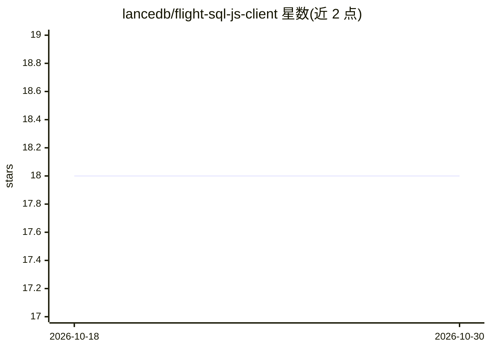

# lancedb/flight-sql-js-client

⭐ 18 · JavaScript · Apache-2.0 · 推送 2026-10-05 · [GitHub](https://github.com/lancedb/flight-sql-js-client) · 组织维护

**JavaScript 开发者的 FlightSQL 查询客户端**

由 LanceDB 维护的 npm 库，用于在 JavaScript/Node 应用中连接 FlightSQL 服务器并执行查询，结果可返回对象数组或 Arrow 表。提供 npm 安装，当前测试均在 Node 上进行。README 声明客户端处于实验阶段且在密集开发中。Arrow 表跨 API 边界传递要求应用与本包使用完全相同版本的 Arrow 包且在同一上下文加载，在 Webpack/Rollup 等打包器下常失败，建议改用 collectToObjects。

## 筛选速览

| 维度 | 判定 | 备注 |
|---|---|---|
| AI 角色 | `ai-ecosystem` | LLM/agent 周边工具 |
| 许可风险 | `permissive` | Apache-2.0 |
| 部署形态 | `library` | 以包/库形式分发 |
| 模型依赖 | — | README 未给出锁定关系 |
| 硬件要求 | — | 无带数字的原话,不猜 |
| 安装摩擦 | `low` | 无编译、无系统依赖或容器化 |
| 成熟度 | `idea` | |

## 能力要点

- 连接 FlightSQL 服务器并执行 SQL 查询
- 查询结果可返回对象数组或 Arrow 表
- 以 npm 包 @lancedb/arrow-flight-sql-client 形式提供

## 适用场景

- 在 Node 应用中查询 FlightSQL 兼容的数据库（如 LanceDB）
- 以 Arrow 格式获取查询结果做进一步数据处理

## 场景标签

 · 领域:数据库/数据基础设施

## 证据(README 行号)

> L3: This is a JavaScript client for FlightSQL. It allows you to easily query FlightSQL servers from your JavaScript appl
> L23: import { Client } from "@lancedb/arrow-flight-sql-client";

## 星数曲线

2026-10-18 18 → 2026-10-30 18（+0）

---
*卡片 v1 · prompt 1.4 · 生成 2026-10-29 · 置信度 mid · 依据 README sha `5c0930f599df` · [字段定义](../../DATASET.md)*
