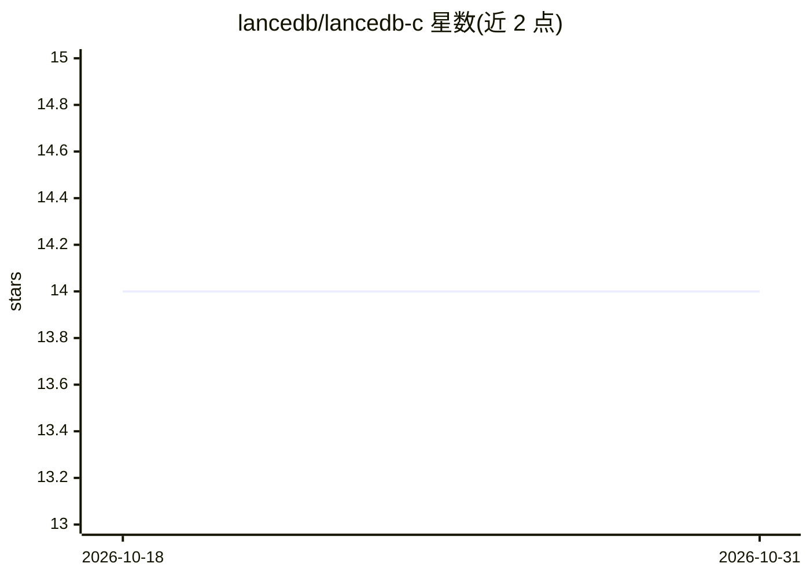

# lancedb/lancedb-c

⭐ 14 · C++ · Apache-2.0 · 推送 2026-10-21 · [GitHub](https://github.com/lancedb/lancedb-c) · 组织维护

**LanceDB 的 C/C++ FFI 绑定，供 C 系应用使用向量数据库**

由 LanceDB 官方维护的 C FFI 绑定：Rust FFI 实现核心逻辑，暴露 C API 头文件，使 C/C++ 应用可调用 LanceDB 的连接管理与全部功能。构建依赖 Rust 工具链、CMake 3.15+、支持 C++20 的编译器、Apache Arrow C++ 库与 pkg-config，需从源码编译（CMake 或手动 cargo build + g++）。测试使用 Catch2（构建时自动拉取），可选 valgrind 与覆盖率报告，文档由 Doxygen/Sphinx 生成并自动发布至 GitHub Pages。

## 筛选速览

| 维度 | 判定 | 备注 |
|---|---|---|
| AI 角色 | `ai-ecosystem` | LLM/agent 周边工具 |
| 许可风险 | `permissive` | Apache-2.0 |
| 部署形态 | `library` | 以包/库形式分发 |
| 模型依赖 | — | README 未给出锁定关系 |
| 硬件要求 | — | 无带数字的原话,不猜 |
| 安装摩擦 | `medium` | 含编译或系统依赖之一 |
| 成熟度 | — | 结构信号不足 |

## 能力要点

- Rust FFI 实现 + C 头文件的 C/C++ 绑定
- CMake 一键构建与手动构建两条路径
- Catch2 测试框架（构建时自动获取）
- Doxygen/Sphinx 文档自动发布至 GitHub Pages

## 适用场景

- C/C++ 应用中接入 LanceDB 向量数据库
- 嵌入式或非 Python/Rust 技术栈使用 LanceDB

## 场景标签

`向量数据库` · 领域:知识与检索

## 证据(README 行号)

> L1: # LanceDB C Bindings
> L3: This repository contains comprehensive C FFI bindings for LanceDB, allowing you to use all LanceDB functionality fro

## 星数曲线

2026-10-18 14 → 2026-10-31 14（+0）

---
*卡片 v1 · prompt 1.4 · 生成 2026-10-31 · 置信度 mid · 依据 README sha `45bc3357525b` · [字段定义](../../DATASET.md)*
