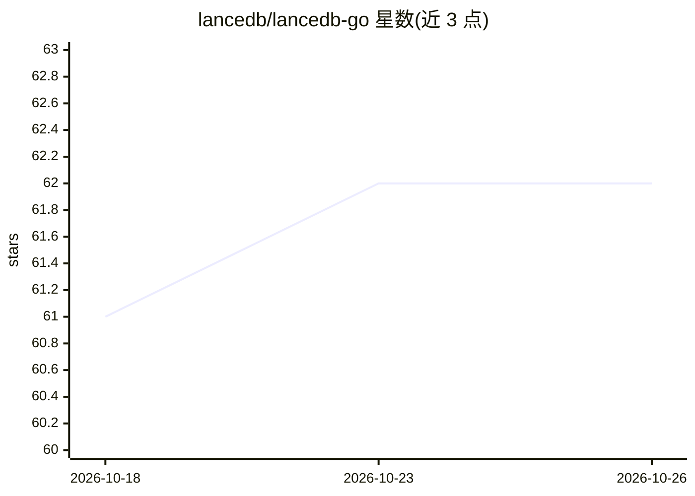

# lancedb/lancedb-go

⭐ 62 · Go · Apache-2.0 · 推送 2026-05-09 · [GitHub](https://github.com/lancedb/lancedb-go) · 组织维护

**LanceDB 的 Go SDK：预编译原生库三步接入向量数据库**

为 LanceDB 向量数据库提供的官方 Go 语言绑定，通过预编译的原生二进制库（Rust 编译产物）消除本地构建依赖：用户先用脚本下载平台对应的原生库与 C 头文件，再 go get 模块并设置 CGO 环境变量即可编译使用。支持 macOS/Linux/Windows 多平台。功能覆盖 CRUD、向量与混合检索、IVF/HNSW 等索引管理、批量写入、S3/MinIO/Azure/GCS 存储配置、RRF 重排与优化操作，examples 目录提供 13 组示例。

## 筛选速览

| 维度 | 判定 | 备注 |
|---|---|---|
| AI 角色 | `ai-ecosystem` | LLM/agent 周边工具 |
| 许可风险 | `permissive` | Apache-2.0 |
| 部署形态 | `None` |  |
| 模型依赖 | — | README 未给出锁定关系 |
| 硬件要求 | — | 无带数字的原话,不猜 |
| 安装摩擦 | `medium` | 含编译或系统依赖之一 |
| 成熟度 | — | 结构信号不足 |

## 能力要点

- 预编译原生二进制，无需安装 Rust 或其他构建工具
- 支持向量搜索、混合检索（向量+FTS+RRF 融合）
- 向量索引 IVF-PQ/IVF-Flat/HNSW-PQ/HNSW-SQ 与标量/全文索引
- 本地、S3、MinIO、Azure Blob、GCS 多种存储后端

## 适用场景

- Go 项目中接入 LanceDB 做向量相似度检索
- 构建带元数据过滤与混合检索的检索系统
- 跨平台分发无需 Rust 工具链的 Go 应用

## 场景标签

`向量数据库` · 领域:知识与检索

## 证据(README 行号)

> L3: A Go library for LanceDB with **pre-built native binaries**.
> L89: 2. **Vector Search** - Vector similarity search

## 星数曲线

2026-10-18 61 → 2026-10-26 62（+1）

---
*卡片 v1 · prompt 1.4 · 生成 2026-10-24 · 置信度 high · 依据 README sha `7cd4e7b0da68` · [字段定义](../../DATASET.md)*
