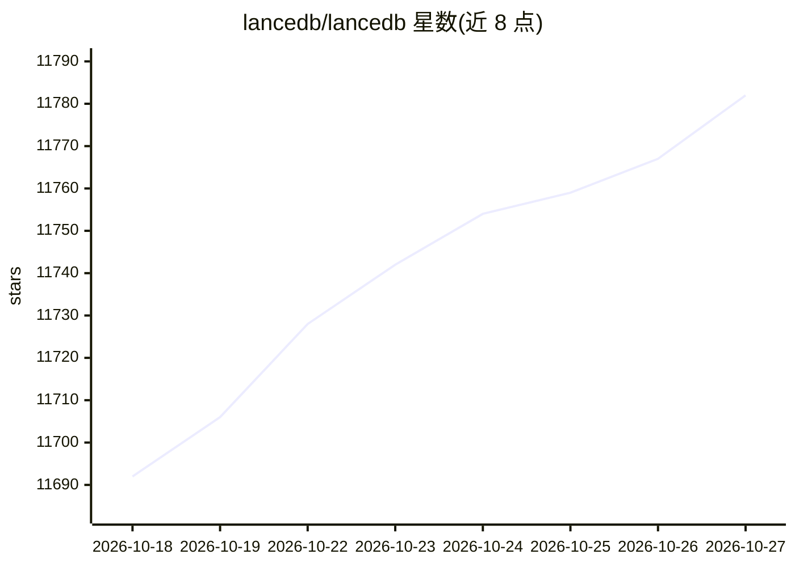

# lancedb/lancedb

⭐ 11,782 · Rust · Apache-2.0 · 推送 2026-10-26 · [GitHub](https://github.com/lancedb/lancedb) · [官网](https://lancedb.com/docs) · 组织维护

**面向开发者的嵌入式多模态向量检索库（Lance 列存格式）**

LanceDB 是构建在 Lance 列式格式之上的嵌入式向量检索库，提供向量相似度搜索、全文检索与 SQL 查询，支持存储与查询向量、元数据及多模态数据（文本、图像、视频、点云等）。功能包括零拷贝、自动数据版本管理、构建向量索引时的 GPU 支持；提供 Python、TypeScript、Rust SDK 与 REST API，并与 LangChain、LlamaIndex、Arrow、Pandas、Polars、DuckDB 等集成。开源版本可本地运行，另提供云端与企业版产品线。

## 筛选速览

| 维度 | 判定 | 备注 |
|---|---|---|
| AI 角色 | `ai-ecosystem` | LLM/agent 周边工具 |
| 许可风险 | `permissive` | Apache-2.0 |
| 部署形态 | `None` |  |
| 模型依赖 | — | README 未给出锁定关系 |
| 硬件要求 | — | 无带数字的原话,不猜 |
| 安装摩擦 | `low` | 无编译、无系统依赖或容器化 |
| 成熟度 | — | 结构信号不足 |

## 能力要点

- 向量相似度搜索、全文搜索与 SQL 三种检索方式
- 基于 Lance 列式格式，支持零拷贝与自动版本管理
- 存储多模态数据：文本、图像、视频、点云等
- 提供 Python/TypeScript/Rust SDK 与 REST API

## 适用场景

- 为 AI 应用搭建本地或云端的向量检索与语义搜索
- 存储并检索图像、视频等多模态数据
- 构建推荐系统或相似内容搜索

## 场景标签

`向量数据库` `语义搜索` · 领域:知识与检索

## 证据(README 行号)

> L17: LanceDB is designed for fast, scalable, and production-ready vector search. It is built on top of the Lance columna
> L40: - **Seamless Integration**: Python, Node.js, Rust, and REST APIs for easy integration. Native Python and Javascript

## 星数曲线

2026-10-18 11,692 → 2026-10-27 11,782（+90）

---
*卡片 v1 · prompt 1.4 · 生成 2026-10-20 · 置信度 high · 依据 README sha `4b70f5297cba` · [字段定义](../../DATASET.md)*
