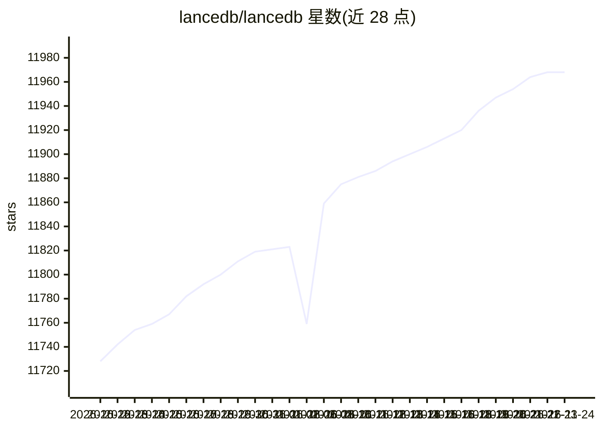

# lancedb/lancedb

⭐ 11,968 · Rust · Apache-2.0 · 推送 2026-11-22 · [GitHub](https://github.com/lancedb/lancedb) · [官网](https://lancedb.com/docs) · 组织维护

**面向多模态 AI 应用的嵌入式向量检索数据库**

基于 Lance 列式存储格式的开源嵌入式检索库，运行于应用进程内，数据可存本地磁盘或对象存储。提供向量相似度搜索、全文搜索与 SQL 查询，支持存储、索引和过滤文本、图像、视频、点云等多模态数据与向量，规模可达 PB 级，索引构建支持 GPU，含零拷贝与自动版本管理。提供 Python/TypeScript/Rust SDK 与 REST API，商业版 LanceDB Enterprise 提供分布式搜索与安全能力。

## 筛选速览

| 维度 | 判定 | 备注 |
|---|---|---|
| AI 角色 | `ai-ecosystem` | LLM/agent 周边工具 |
| 许可风险 | `permissive` | Apache-2.0 |
| 部署形态 | `None` |  |
| 模型依赖 | — | README 未给出锁定关系 |
| 硬件要求 | — | 无带数字的原话,不猜 |
| 安装摩擦 | `low` | 无编译、无系统依赖或容器化 |
| 成熟度 | — | 结构信号不足 |

## 能力要点

- 向量相似度搜索、全文搜索与 SQL 三种检索方式
- 多模态数据（文本/图像/视频/点云）存储与过滤
- 嵌入式运行，数据存本地磁盘或对象存储，无额外基础设施
- 索引构建支持 GPU，零拷贝与自动版本管理

## 适用场景

- 为 RAG 应用搭建本地向量检索层
- 多模态数据（图像/视频）的相似度搜索
- 推荐系统与语义搜索场景的向量存储与查询
- 与 LangChain/LlamaIndex 配合构建 AI 应用数据管道

## 场景标签

`向量数据库` · 领域:知识与检索

## 证据(README 行号)

> L17: LanceDB is designed for fast, scalable, and production-ready vector search. It is built on top of the Lance columna
> L40: - **Seamless Integration**: Python, Node.js, Rust, and REST APIs for easy integration. Native Python and Javascript
> L41: - **Rich Ecosystem**: Integrations with **LangChain** 🦜️🔗, **LlamaIndex** 🦙, Apache-Arrow, Pandas, Polars, DuckDB a

## 星数曲线

2026-10-22 11,728 → 2026-11-24 11,968（+240）

---
*卡片 v1 · prompt 1.4 · 生成 2026-11-22 · 置信度 high · 依据 README sha `17f2fb76e539` · [字段定义](../../DATASET.md)*
