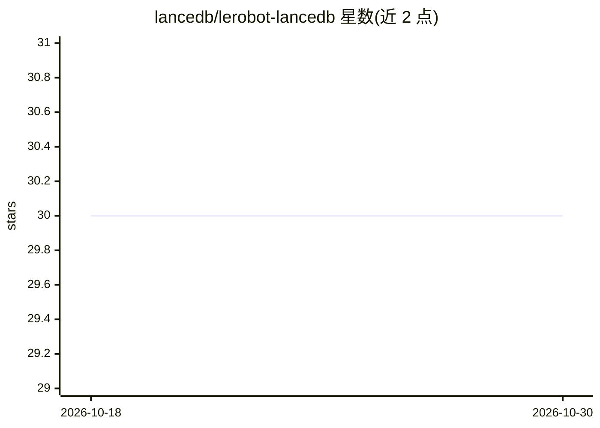

# lancedb/lerobot-lancedb

⭐ 30 · Python · NOASSERTION · 推送 2026-09-30 · [GitHub](https://github.com/lancedb/lerobot-lancedb) · [官网](https://lancedb.github.io/lerobot-lancedb/) · 组织维护

**把 LeRobot 机器人数据集转为 Lance 格式并直接训练的加载器**

提供三个组件：lerobot-lance-convert 将 LeRobot v3.0 数据集（本地目录或 Hub id）转为三表 Lance 布局；LanceDBDataset 是 map-style 训练加载器，支持本地磁盘或 s3://gs://hf:// 对象存储按字节范围随机读取，无需先下载整个数据集；lerobot-lance-doctor 对上游格式数据集做五项只读审计（元数据、episode 边界、parquet 与视频完整性）。面向使用 LeRobot 做机器人学习训练的开发者。限制：依赖 beta 版 lancedb>=0.37.1b0（发布于 fury.io 而非 PyPI）；lerobot-train CLI 直接识别 Lance 根目录需等待上游 PR 合并。0.3.0 之前的旧插件已废弃。

## 筛选速览

| 维度 | 判定 | 备注 |
|---|---|---|
| AI 角色 | `ai-ecosystem` | LLM/agent 周边工具 |
| 许可风险 | `none` | NOASSERTION |
| 部署形态 | `library` | 以包/库形式分发 |
| 模型依赖 | — | README 未给出锁定关系 |
| 硬件要求 | — | 无带数字的原话,不猜 |
| 安装摩擦 | `low` | 无编译、无系统依赖或容器化 |
| 成熟度 | — | 结构信号不足 |

## 能力要点

- map-style 随机访问：从 S3 按批次精确取字节区间，实现真全局 shuffle
- 转换器 + 审计器 + 训练加载器三件套，一个包内完成往返
- doctor 工具运行五项只读检查，退出码即失败数，可直接接入 CI
- 视频以 blob v2 列存储并建字节索引，8 帧窗口仅传输约 100 KB

## 适用场景

- 把大型 LeRobot 数据集（如 386 GB 的 droid）放 S3 上直接训练，不先下载
- 训练前检查公开机器人数据集的静默缺陷（孤儿 parquet、缺帧视频等）
- 在本地磁盘用更快的格式训练已有的 LeRobot 数据

## 场景标签

`MLOps` · 领域:训练与推理

## 证据(README 行号)

> L9: - **`lerobot-lance-convert`** - turns a LeRobot v3.0 dataset (local dir or Hub id)
> L14: - **`LanceDBDataset`** - the map-style training loader for the Lance layout, so
> L19: The Lance layout is map-style random access over object storage: a training

## 星数曲线

2026-10-18 30 → 2026-10-30 30（+0）

---
*卡片 v1 · prompt 1.4 · 生成 2026-10-26 · 置信度 high · 依据 README sha `52b3b8c98689` · [字段定义](../../DATASET.md)*
