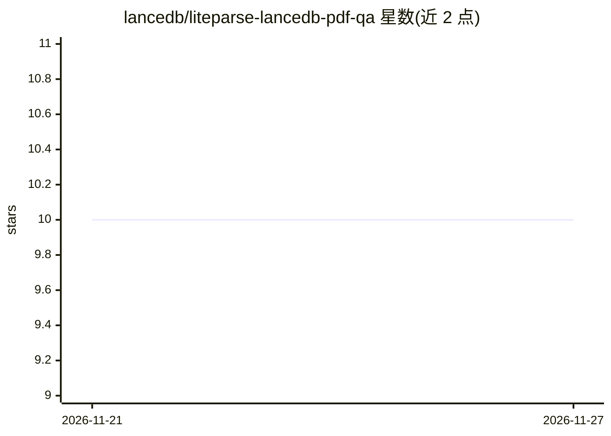

# lancedb/liteparse-lancedb-pdf-qa

⭐ 10 · Python · 推送 2026-06-30 · [GitHub](https://github.com/lancedb/liteparse-lancedb-pdf-qa) · 组织维护

**把视觉型 PDF 报告解析为本地 LanceDB 多模态证据库并评测检索**

可复现的示例工程，作为博客文章的配套代码：用 LiteParse（LlamaIndex 出品，Rust 内核、无云端调用）解析 ESG 报告 PDF，产出文本、页面截图与图表，归一化为 documents/pages/chunks/assets 五张表写入 LanceDB，并配合 OpenAI 文本嵌入与 OpenCLIP 图像嵌入提供 chunks/pages/assets/images/hybrid_bundle 五种检索模式；可选的答案代理与 LLM judge 直接从 LanceDB 读取图片字节作答评分。基于 Climate Finance Bench 六份报告 50 道页级标注问题做检索基准，无 API key 时可退回本地确定性哈希嵌入跑离线冒烟测试。

## 筛选速览

| 维度 | 判定 | 备注 |
|---|---|---|
| AI 角色 | `ai-native` | 本体是模型或模型工具 |
| 许可风险 | `none` | — |
| 部署形态 | `None` |  |
| 模型依赖 | — | README 未给出锁定关系 |
| 硬件要求 | — | 无带数字的原话,不猜 |
| 安装摩擦 | `low` | 无编译、无系统依赖或容器化 |
| 成熟度 | — | 结构信号不足 |

## 能力要点

- PDF→归一化记录→LanceDB 多模态存储全流程本地运行，解析无需 LLM 与 API key
- 五种检索模式（chunks/pages/assets/images/hybrid_bundle），CLIP 文本到图像搜索
- 无 API key 时回退本地确定性哈希嵌入，支持离线冒烟测试
- 内置下载、解析、建库、检索评测、答案评测的完整脚本链与指标输出

## 适用场景

- 把 ESG/财务类 PDF 报告建成可检索的本地证据库
- 在页级标注基准上评测多模态检索效果
- 复现或扩展本地多模态 PDF 问答流水线

## 场景标签

`模型评测` `多模态` `文档解析` `RAG` · 领域:评测与运维

## 证据(README 行号)

> L3: A small, fully reproducible demo that turns messy, visual ESG reports into a local,
> L13:   -> LanceDB                  text, blobs, vectors, and metadata in one store
> L15:   -> optional answer agent    PydanticAI answer + LLM judge, reading image bytes from LanceDB

## 星数曲线

2026-11-21 10 → 2026-11-27 10（+0）

---
*卡片 v1 · prompt 1.4 · 生成 2026-11-21 · 置信度 high · 依据 README sha `b22e51e66375` · [字段定义](../../DATASET.md)*
