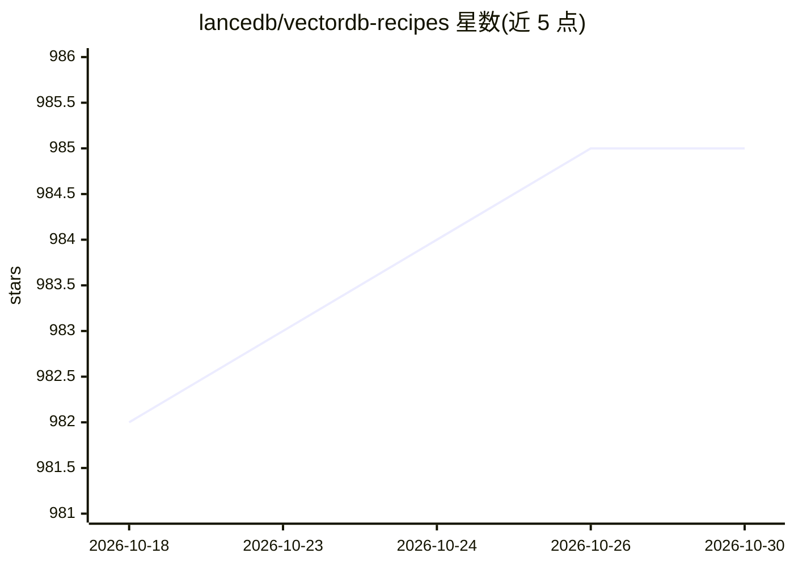

# lancedb/vectordb-recipes

⭐ 985 · Jupyter Notebook · Apache-2.0 · 推送 2026-04-24 · [GitHub](https://github.com/lancedb/vectordb-recipes) · 组织维护

**面向 GenAI 开发者的多模态/RAG/Agent 示例与教程合集**

LanceDB 团队维护的示例与教程仓库：以 LanceDB（开源无服务器向量数据库）为基础，提供从零构建、多模态检索、RAG、向量搜索、聊天机器人、评测、AI Agent、推荐系统、概念讲解等分类的可运行 notebook 与脚本，另含一批可直接使用的 Python/Web 应用（写作助手、求职搜索、表情包搜索等）。多数示例以 Colab notebook 形式打开，覆盖 LangChain、LlamaIndex、CrewAI 等生态组合。给希望在自有数据管线中快速验证 GenAI 原型的开发者使用。

## 筛选速览

| 维度 | 判定 | 备注 |
|---|---|---|
| AI 角色 | `ai-knowledge` | 知识聚合/清单类 |
| 许可风险 | `permissive` | Apache-2.0 |
| 部署形态 | `None` |  |
| 模型依赖 | — | README 未给出锁定关系 |
| 硬件要求 | — | 无带数字的原话,不猜 |
| 安装摩擦 | `low` | 无编译、无系统依赖或容器化 |
| 成熟度 | — | 结构信号不足 |

## 能力要点

- 示例按从零构建/多模态/RAG/向量搜索/聊天机器人/评测/Agent/推荐系统等主题组织
- 多数条目提供 Open In Colab 的交互式 notebook
- 含可复用的 Node/Web 应用项目（写作助手、文章推荐、求职搜索等）
- 全部基于 LanceDB，支持 Python 数据生态与原生 TypeScript SDK

## 适用场景

- 几分钟内从想法做出 GenAI 应用的 PoC
- 学习并复用各种 RAG 变体（HyDE、GraphRAG、Agentic RAG 等）实现
- 为 AI Agent、推荐系统、多模态搜索项目找起步代码

## 场景标签

`教程课程` `RAG` `向量数据库` · 领域:知识与检索

## 证据(README 行号)

> L4: This repository contains examples, applications, starter code, & tutorials to help you kickstart your GenAI projects
> L15: - Applications - Ready to use Python and web apps using applied LLMs, VectorDB and GenAI tools
> L187: ## Projects & Applications

## 星数曲线

2026-10-18 982 → 2026-10-30 985（+3）

---
*卡片 v1 · prompt 1.4 · 生成 2026-10-21 · 置信度 high · 依据 README sha `132a37d6a45a` · [字段定义](../../DATASET.md)*
