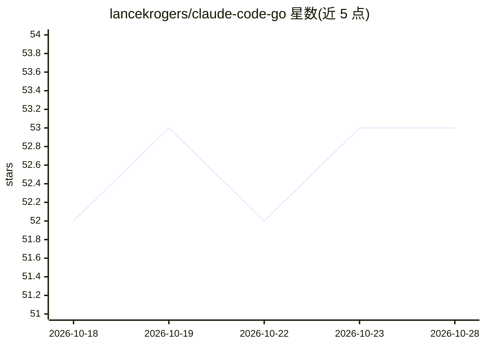

# lancekrogers/claude-code-go

⭐ 53 · Go · MIT · 推送 2026-10-28 · [GitHub](https://github.com/lancekrogers/claude-code-go) · 个人维护

**非官方 Go SDK：在 Go 程序中封装调用 Claude Code CLI**

用 Go 库封装 Claude Code CLI 的非交互 `-p/--print` 工作流，供开发者在 Go 应用中构建 AI 编码助手、自动化工作流与 agent。提供流式输出、多轮会话（resume/fork）、MCP 集成、细粒度工具权限、插件系统、预算跟踪、子 agent 编排与重试策略。运行前置条件为已安装 Claude Code CLI 并具备 Claude 订阅或 Anthropic API key；交互式会话与 auth/mcp/plugins 等管理子命令不在覆盖范围内。

## 筛选速览

| 维度 | 判定 | 备注 |
|---|---|---|
| AI 角色 | `ai-ecosystem` | LLM/agent 周边工具 |
| 许可风险 | `permissive` | MIT |
| 部署形态 | `None` |  |
| 模型依赖 | — | README 未给出锁定关系 |
| 硬件要求 | — | 无带数字的原话,不猜 |
| 安装摩擦 | `low` | 无编译、无系统依赖或容器化 |
| 成熟度 | — | 结构信号不足 |

## 能力要点

- 封装 claude -p 的完整 flag 面（text/json/stream-json 输出）
- 流式响应、会话管理（自定义 ID、fork、持久化）
- MCP 集成与细粒度工具权限（allowlist/blocklist/模式）
- 插件系统、预算跟踪、子 agent 编排与可配置重试

## 适用场景

- 在 Go 服务中集成 Claude Code 完成编码任务
- 构建带预算控制与权限管理的自动化 agent 工作流
- 通过流式接口实时展示 Claude Code 输出

## 场景标签

`Agent 框架` · 领域:Agent 开发

## 证据(README 行号)

> L9: A comprehensive Go library for programmatically integrating the Claude Code CLI into Go applications. Build AI-power
> L13: This SDK intentionally wraps the prompt-oriented `claude -p` workflow. Interactive sessions and management subcomma
> L64: - **Claude Code CLI**: Installed and accessible in PATH

## 星数曲线

2026-10-18 52 → 2026-10-28 53（+1）

---
*卡片 v1 · prompt 1.4 · 生成 2026-10-24 · 置信度 high · 依据 README sha `04892d97de18` · [字段定义](../../DATASET.md)*
