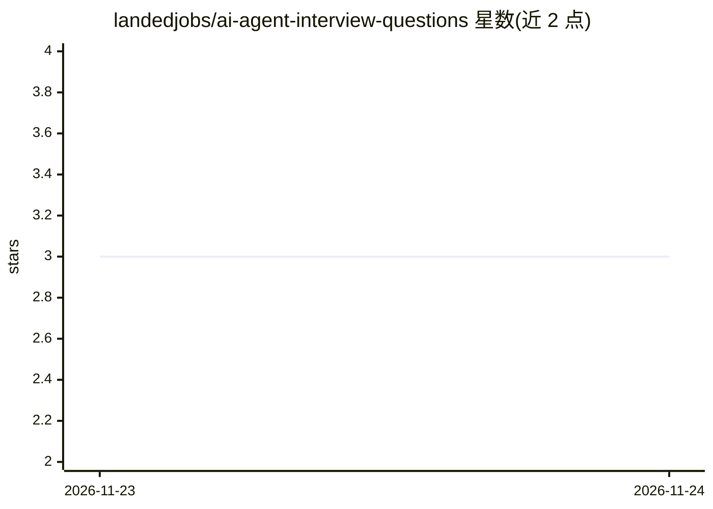

# landedjobs/ai-agent-interview-questions

⭐ 3 · Python · MIT · 推送 2026-11-12 · [GitHub](https://github.com/landedjobs/ai-agent-interview-questions) · [官网](https://www.landed.jobs/?utm_source=github&utm_medium=referral&utm_campaign=github-ai-agent-interview-questions&utm_content=repo-about) · 组织维护

**AI agent 工程师面试题库：114 题含答案、5 个系统设计**

面向 2026 年 AI agent 工程师求职者的面试准备资料库：114 道题（39 Core/64 Senior/11 Staff）覆盖基础概念、工具调用、规划、记忆与上下文工程、MCP、多智能体、评测、可靠性与安全等 11 个主题，每题含难度标签、60-90 秒答案、追问与来源链接；另附 5 个系统设计场景和仅用标准库实现的可运行 Python 代码（无需 API key）。提供一周学习计划，内容由 Landed 维护，MIT 许可。

## 筛选速览

| 维度 | 判定 | 备注 |
|---|---|---|
| AI 角色 | `ai-knowledge` | 知识聚合/清单类 |
| 许可风险 | `permissive` | MIT |
| 部署形态 | `None` |  |
| 模型依赖 | — | README 未给出锁定关系 |
| 硬件要求 | — | 无带数字的原话,不猜 |
| 安装摩擦 | `low` | 无编译、无系统依赖或容器化 |
| 成熟度 | — | 结构信号不足 |

## 能力要点

- 114 道题按 11 主题组织，含难度分级与追问
- 5 个 worked 系统设计场景
- 标准库实现的 agent loop/工具注册/重试代码，无需 API key 可运行测试
- 一周学习计划与 20 道必背题清单

## 适用场景

- 准备 AI agent 工程师岗位面试
- 按一周计划系统学习 agent 主题
- 用 code/ 目录代码练习 agent loop 编码题

## 场景标签

`教程课程` · 领域:学习与行业

## 证据(README 行号)

> L12: **AI agent engineer interview prep for 2026**: 114 questions with senior answers and follow-ups, 5 worked system de
> L19: Agent engineering interviews ask what happens when a model is allowed to act. Can you design tools a model uses cor

## 星数曲线

2026-11-23 3 → 2026-11-24 3（+0）

---
*卡片 v1 · prompt 1.4 · 生成 2026-11-23 · 置信度 high · 依据 README sha `071155f4c6ac` · [字段定义](../../DATASET.md)*
