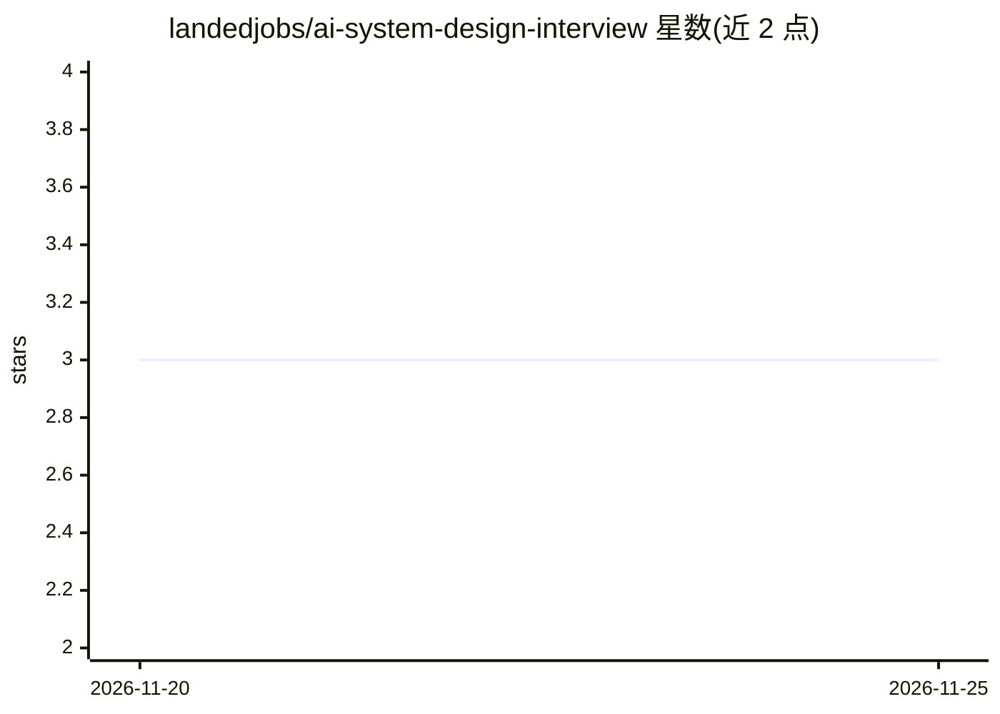

# landedjobs/ai-system-design-interview

⭐ 3 · MIT · 推送 2026-11-17 · [GitHub](https://github.com/landedjobs/ai-system-design-interview) · [官网](https://www.landed.jobs/?utm_source=github&utm_medium=referral&utm_campaign=github-ai-system-design-interview&utm_content=repo-about) · 组织维护

**AI 工程师的 LLM 系统设计面试题解集：16 篇完整答案**

由 Landed 维护的 LLM/GenAI 系统设计面试准备资料库，收录 16 个完整题解（RAG、企业搜索、客服 agent、推理服务、LLM 网关、评测流水线、护栏、语音 agent 等），每篇含带假设的数值估算、Mermaid 架构图、评测计划、权衡表与 45 分钟作答框架；另附常用数值速查表（KV cache、显存、延迟、价格）与一周学习计划。面向准备 AI/ML 工程师面试轮的候选人，内容为文档而非软件，无安装运行。

## 筛选速览

| 维度 | 判定 | 备注 |
|---|---|---|
| AI 角色 | `ai-knowledge` | 知识聚合/清单类 |
| 许可风险 | `permissive` | MIT |
| 部署形态 | `None` |  |
| 模型依赖 | — | README 未给出锁定关系 |
| 硬件要求 | — | 无带数字的原话,不猜 |
| 安装摩擦 | `low` | 无编译、无系统依赖或容器化 |
| 成熟度 | — | 结构信号不足 |

## 能力要点

- 16 个系统设计题解：估算、架构图、评测计划、权衡与失败模式
- 统一八步作答框架（framework.md）与面试轮时间线
- 数值速查表：KV cache、权重显存、HNSW、延迟与价格带宽
- 标注已核实的真实公司面试题来源

## 适用场景

- 准备 AI 工程师/ML 工程师的系统设计面试轮
- 按公司查找对应的面试指南与题型
- 按一周计划做限时模拟练习

## 场景标签

`教程课程` · 领域:学习与行业

## 证据(README 行号)

> L12: **16 worked LLM and GenAI system design answers, each with estimates, a diagram, an eval plan and trade-offs, plus 
> L21: This repo is a set of full answers. Each design walks one prompt the way a strong candidate would in 45 minutes: cl

## 星数曲线

2026-11-20 3 → 2026-11-25 3（+0）

---
*卡片 v1 · prompt 1.4 · 生成 2026-11-21 · 置信度 high · 依据 README sha `fa49eb076c27` · [字段定义](../../DATASET.md)*
