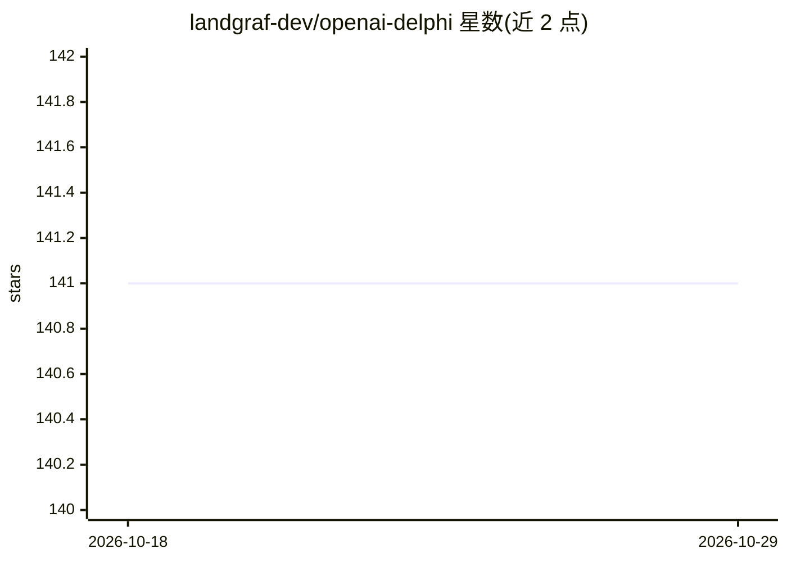

# landgraf-dev/openai-delphi

⭐ 141 · Pascal · MIT · 推送 2026-09-21 · [GitHub](https://github.com/landgraf-dev/openai-delphi) · 个人维护

**Delphi/Lazarus 的 OpenAI API 客户端库**

面向 Delphi 与 Lazarus/FPC（Free Pascal Compiler）的非官方 OpenAI API 客户端库，使 Pascal 应用可直接调用 ChatGPT、DALL·E 等 OpenAI 服务。安装方式为将 Source 文件夹加入 IDE 库路径或项目源码路径，通过 uses 引入 OpenAIClient 与 OpenAIDtos 单元，配置账户 API key 后创建客户端使用。无需第三方依赖，支持自定义请求工厂（如设置自定义组织 HTTP 头），并给出与 WPP4Delphi 集成 WhatsApp 消息场景的示例。注意事项：客户端对象需手动释放以避免内存泄漏，且因需 secret key 不建议用于客户端应用。

## 筛选速览

| 维度 | 判定 | 备注 |
|---|---|---|
| AI 角色 | `ai-ecosystem` | LLM/agent 周边工具 |
| 许可风险 | `permissive` | MIT |
| 部署形态 | `None` |  |
| 模型依赖 | — | README 未给出锁定关系 |
| 硬件要求 | — | 无带数字的原话,不猜 |
| 安装摩擦 | `low` | 无编译、无系统依赖或容器化 |
| 成熟度 | — | 结构信号不足 |

## 能力要点

- 覆盖多数 OpenAI API 端点的 Delphi/FPC 客户端接口
- 无需第三方依赖，支持 System.Net.HttpClient 的 Delphi 版本及 Lazarus/FPC
- IRestRequestFactory 自定义请求（如自定义组织 HTTP 头）
- 提供与 WPP4Delphi 集成 WhatsApp 的示例

## 适用场景

- 在 Delphi 或 Lazarus 应用中调用 ChatGPT/DALL·E 等 OpenAI 服务
- Pascal 项目中构建自定义请求头的 OpenAI 调用
- 结合 WPP4Delphi 实现 WhatsApp 聊天机器人

## 场景标签

 · 领域:LLM API 客户端库

## 证据(README 行号)

> L3: OpenAI for Delphi is a client library to connect to the OpenAI API from Delphi and Lazarus/FPC (Free Pascal Compiler
> L4: From this library you can use popular OpenAI services, like ChatGPT, directly from your Delphi or Lazarus applicatio

## 星数曲线

2026-10-18 141 → 2026-10-29 141（+0）

---
*卡片 v1 · prompt 1.4 · 生成 2026-10-22 · 置信度 high · 依据 README sha `02ff2d91b330` · [字段定义](../../DATASET.md)*
