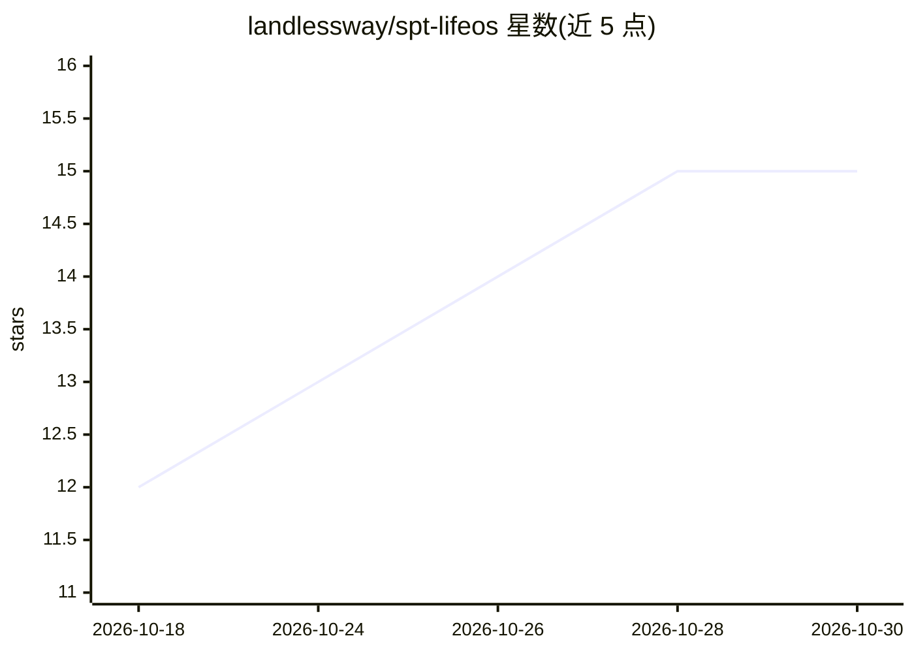

# landlessway/spt-lifeos

⭐ — · [GitHub]() · 个人维护 · 中文 README

**给个人用户的知识管理 Agent 提示词系统：五层架构第二大脑**

LifeOS 是一套用于配合 AI Agent 软件使用的第二大脑文件结构，按核心（IDENTITY 身份配置）、进化（成果沉淀）、输入（金句/收藏/灵感/阅读）、加工（Wiki 内容单元库、思考系统）、输出（内容创作、表达系统）五层组织 Markdown 文件夹，共涉及 10 个 Agent。核心机制包括将旧内容拆解为 QST/CON/OPI/CAS/SOL 五类可复用单元、从单元库装配选题骨架、用 content-processor.md 追踪拆解进度。用户下载后编辑 IDENTITY 三文件（TELOS/CONTEXT/PROFILE）即可开始使用，以 MIT 协议开源。

## 筛选速览

| 维度 | 判定 | 备注 |
|---|---|---|
| AI 角色 | `ai-ecosystem` | LLM/agent 周边工具 |
| 许可风险 | `permissive` | — |
| 部署形态 | `None` |  |
| 模型依赖 | — | README 未给出锁定关系 |
| 硬件要求 | — | 无带数字的原话,不猜 |
| 安装摩擦 | `low` | 无编译、无系统依赖或容器化 |
| 成熟度 | — | 结构信号不足 |

## 能力要点

- 五层架构（核心/进化/输入/加工/输出）组织个人知识文件
- IDENTITY 三文件（TELOS/CONTEXT/PROFILE）定义用户身份与偏好
- Wiki 五类内容单元（QST/CON/OPI/CAS/SOL）与选题装配机制
- 10 个 Agent 覆盖输入-加工-输出闭环，成果沉淀至进化层

## 适用场景

- 配合 Claude Code 等 Agent 软件搭建个人知识管理系统
- 把阅读笔记和灵感碎片拆解为可复用内容单元
- 基于已有素材装配选题骨架辅助写作
- 通过表达系统做深度表达训练

## 场景标签

`提示工程` `知识库管理` · 领域:Agent 开发

## 证据(README 行号)

> L9: LifeOS 是一套会自我进化的第二大脑系统。
> L11: 它不是静态的知识库，而是一个能记住你、理解你、随着使用越来越聪明的操作系统。
> L32: |🥷 00-LifeOS|操作系统内核，对话启动时自动加载 IDENTITY|

## 星数曲线

2026-10-18 12 → 2026-10-30 15（+3）

---
*卡片 v1 · prompt 1.4 · 生成 2026-10-30 · 置信度 mid · 依据 README sha `aa0c6b0ef451` · [字段定义](../../DATASET.md)*
