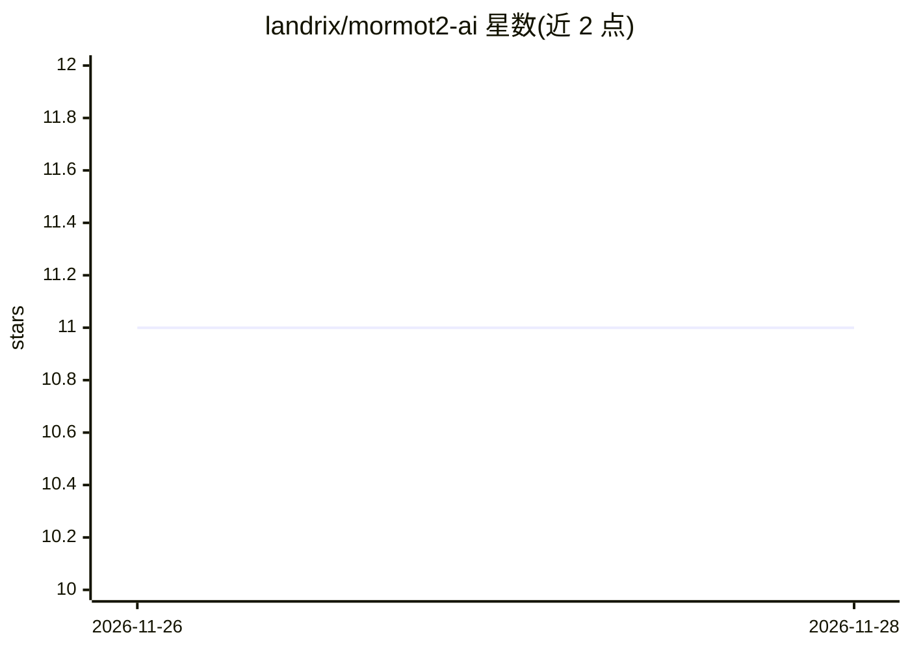

# landrix/mormot2-ai

⭐ 11 · Pascal · NOASSERTION · 推送 2026-11-23 · [GitHub](https://github.com/landrix/mormot2-ai) · 个人维护

**为 FPC/Delphi 开发者提供 MCP 服务、LLM 客户端、向量检索与 RAG 的 mORMot2 扩展库**

面向 Free Pascal 与 Delphi 7–13 的 mORMot2 AI 扩展库，提供 MCP server（stdio/HTTP/Streamable HTTP，OAuth 2.1 可选）、OpenAI/Anthropic 兼容的 LLM 客户端、agent 工具调用循环、嵌入接口、向量存储与 RAG 组件。自带纯 Object Pascal 推理引擎，读取 GGUF/safetensors 权重，在 CPU（NEON/AVX2）、Vulkan 与 CUDA 上运行，支持 Qwen3、Qwen3-MoE、Qwen2.5、SmolLM3、gpt-oss 等模型，运行时不依赖 Python 或外部动态库。

## 筛选速览

| 维度 | 判定 | 备注 |
|---|---|---|
| AI 角色 | `ai-ecosystem` | LLM/agent 周边工具 |
| 许可风险 | `none` | NOASSERTION |
| 部署形态 | `None` |  |
| 模型依赖 | local-ok | 支持本地模型 |
| 硬件要求 | — | 无带数字的原话,不猜 |
| 安装摩擦 | `medium` | 含编译或系统依赖之一 |
| 成熟度 | — | 结构信号不足 |

## 能力要点

- MCP server 支持 stdio、HTTP、Streamable HTTP 与进程内调用，输入 schema 由 RTTI 生成
- 原生 Object Pascal 推理引擎读取 GGUF 与 safetensors，支持 Q8_0/Q4_K/MXFP4 等量化格式
- CPU（NEON/AVX2）、Vulkan（内嵌 SPIR-V）与 CUDA（内嵌 PTX）三种后端，无需随附外部库
- 嵌入器统一接口可切换原生引擎、OpenAI 兼容 API 或 sqlite-lembed

## 适用场景

- 在 Delphi/Pascal 工程中为应用接入 LLM 客户端与工具调用
- 用 mORMot2 搭建带向量检索与 RAG 能力的服务
- 在没有 Python 运行时的环境中本地运行嵌入与对话模型
- 通过 MCP 协议向 agent 暴露 Pascal 编写的工具

## 场景标签

`RAG` `向量数据库` `推理引擎` · 领域:知识与检索

## 证据(README 行号)

> L3: A **mORMot-native** AI extension for **Free Pascal** and **Delphi 7 to 13** — the same
> L4: compiler range as mORMot2. It covers the Model Context Protocol, LLM clients, embeddings,
> L38: |**LLM clients**|`mormot.ai.llm[.openai/.anthropic/.native/.sse/.structured]`|OpenAI wire as lingua franca (OpenAI,

## 星数曲线

2026-11-26 11 → 2026-11-28 11（+0）

---
*卡片 v1 · prompt 1.4 · 生成 2026-11-26 · 置信度 high · 依据 README sha `f0e0836124d0` · [字段定义](../../DATASET.md)*
