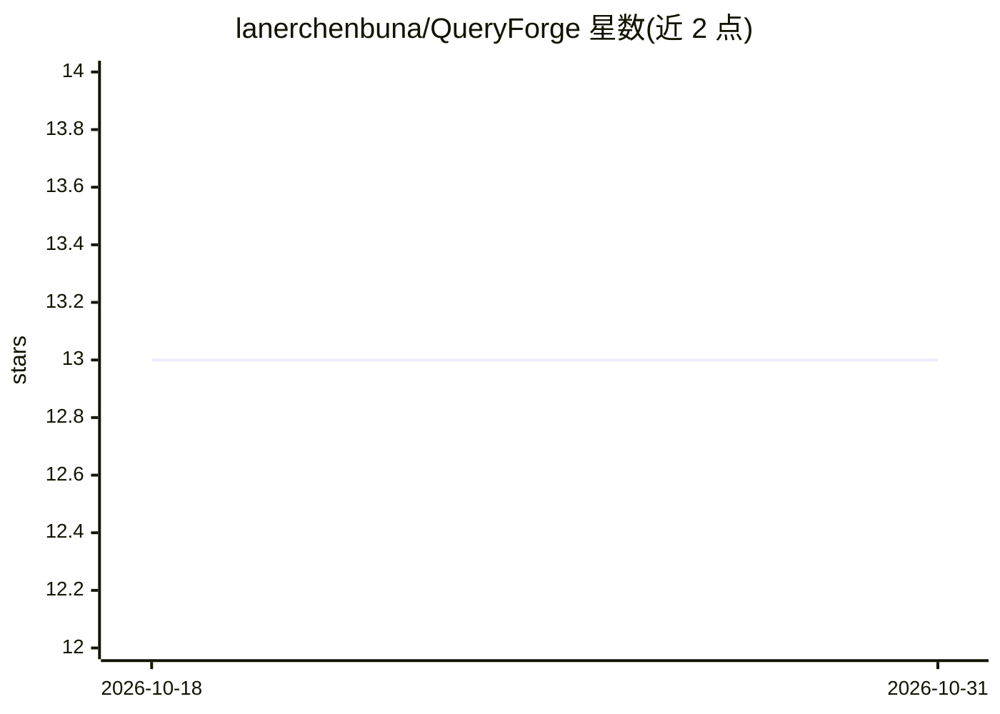

# lanerchenbuna/QueryForge

⭐ 13 · Python · 推送 2026-10-11 · [GitHub](https://github.com/lanerchenbuna/QueryForge) · 个人维护 · 中文 README

**面向业务用户的受治理 NL2SQL 分析平台：自然语言生成可审计 SQL**

本地优先的 AI 数据分析平台：用户先创建或选择数据域，接入 CSV/Parquet/JSON API 构建 SQLite 资产，用 YAML 定义指标、维度、粒度与 Join Path 的语义契约，然后以自然语言提问。生成的 SQL 经 SQLGlot AST 解析、策略校验后以只读单语句执行，拒绝返回结构化 SQL_SECURITY_ERROR；支持反思修复重试、运行产物持久化与 Trust Trace。通过 CLI、REST/SSE、MCP、Gateway 与可视化 Studio 交付。限制：默认面向本地单用户只读 SQLite 分析，未声明开源许可。

## 筛选速览

| 维度 | 判定 | 备注 |
|---|---|---|
| AI 角色 | `ai-native` | 本体是模型或模型工具 |
| 许可风险 | `none` | — |
| 部署形态 | `library` | 以包/库形式分发 |
| 模型依赖 | locked-api |  |
| 硬件要求 | — | 无带数字的原话,不猜 |
| 安装摩擦 | `low` | 无编译、无系统依赖或容器化 |
| 成熟度 | — | 结构信号不足 |

## 能力要点

- SQLGlot AST 解析 + 命名策略校验 + 只读单语句执行的治理管线
- YAML 语义层：指标/维度/粒度/Join Path 与质量规则
- 数据域隔离：数据源、语义契约、策略与运行历史按域隔离
- 多接口交付：CLI、REST/SSE、MCP、Gateway、Studio

## 适用场景

- 在受控语义契约下用自然语言查询业务数据并获得可审计 SQL
- 从 CSV/Parquet 原始数据构建受治理数据资产再分析
- 把 NL2SQL 能力通过 REST/MCP 集成到应用或 IDE 助手

## 场景标签

`数据分析` · 领域:效率与自动化

## 证据(README 行号)

> L7: Turn business questions into safe, traceable SQLite queries—with a semantic layer,
> L25: QueryForge combines that workflow with natural-language-to-SQL, AST-level
> L26: security, read-only execution, bounded recovery, and complete run artifacts.

## 星数曲线

2026-10-18 13 → 2026-10-31 13（+0）

---
*卡片 v1 · prompt 1.4 · 生成 2026-10-31 · 置信度 high · 依据 README sha `248c7641a134` · [字段定义](../../DATASET.md)*
