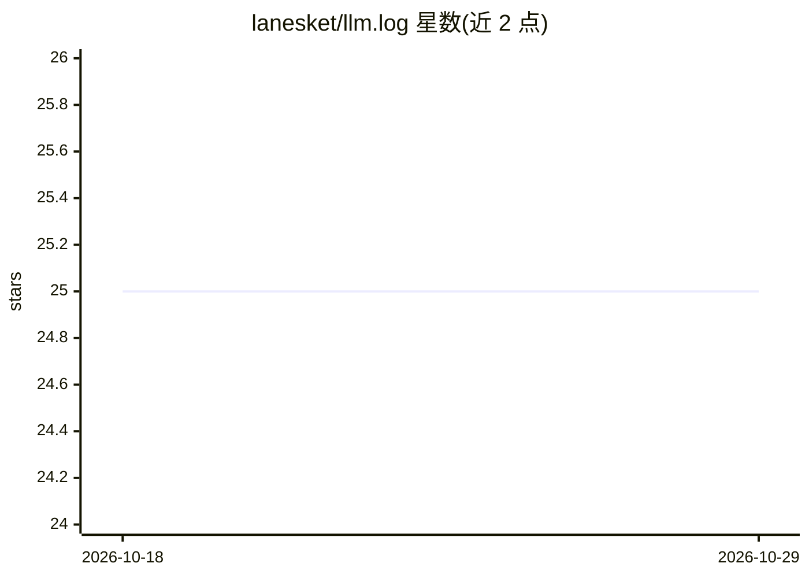

# lanesket/llm.log

⭐ 25 · Go · MIT · 推送 2026-04-04 · [GitHub](https://github.com/lanesket/llm.log) · [官网](https://github.com/lanesket/llm.log) · 个人维护

**本地代理记录 LLM 调用：成本、token 与完整请求响应**

用 Go 编写的单二进制本地 HTTPS 代理，通过 MITM 拦截已知 LLM 域名的流量，记录每次请求/响应全文、token 用量并按 780+ 模型自动更新价格计算成本，数据存本地 SQLite。无需改代码，靠 HTTPS_PROXY 环境变量生效；提供 Web UI、TUI 仪表盘与 CLI，支持 CSV/JSON/JSONL 导出和按期清理请求体。支持 OpenAI、Anthropic、OpenRouter、Groq、Together 等 10 家提供商。限制：经工具自有服务器路由的流量（如带订阅的 Cursor、Copilot）无法记录；需要安装并信任自签 CA 证书。

## 筛选速览

| 维度 | 判定 | 备注 |
|---|---|---|
| AI 角色 | `ai-ecosystem` | LLM/agent 周边工具 |
| 许可风险 | `permissive` | MIT |
| 部署形态 | `desktop` | 安装包/桌面程序 |
| 模型依赖 | locked-api |  |
| 硬件要求 | — | 无带数字的原话,不猜 |
| 安装摩擦 | `low` | 无编译、无系统依赖或容器化 |
| 成熟度 | — | 结构信号不足 |

## 能力要点

- MITM 本地代理捕获完整 prompt/response，零代码改动
- 自动更新 780+ 模型定价并计算成本、缓存 token 拆分
- Web UI + TUI 双仪表盘：热力图、按提供商/模型分解、延迟分析
- 纯 Go 单二进制，无 CGO/Docker 依赖，SQLite 本地存储

## 适用场景

- 查看我在各家 LLM API 上的实际花费与 token 用量
- 审计或回溯某次 LLM 调用的完整 prompt 和响应
- 在 Claude Code 等工具中对比订阅与 API 按量付费成本
- 导出调用记录到 Excel/pandas 做分析

## 场景标签

`LLM 可观测性` · 领域:评测与运维

## 证据(README 行号)

> L25: A lightweight local proxy for LLM observability. It sits between your apps and LLM APIs, captures every request and
> L150:                               ├─ LLM provider? ──▸ MITM ──▸ parse usage ──▸ SQLite

## 星数曲线

2026-10-18 25 → 2026-10-29 25（+0）

---
*卡片 v1 · prompt 1.4 · 生成 2026-10-27 · 置信度 high · 依据 README sha `60bd46cf14ba` · [字段定义](../../DATASET.md)*
