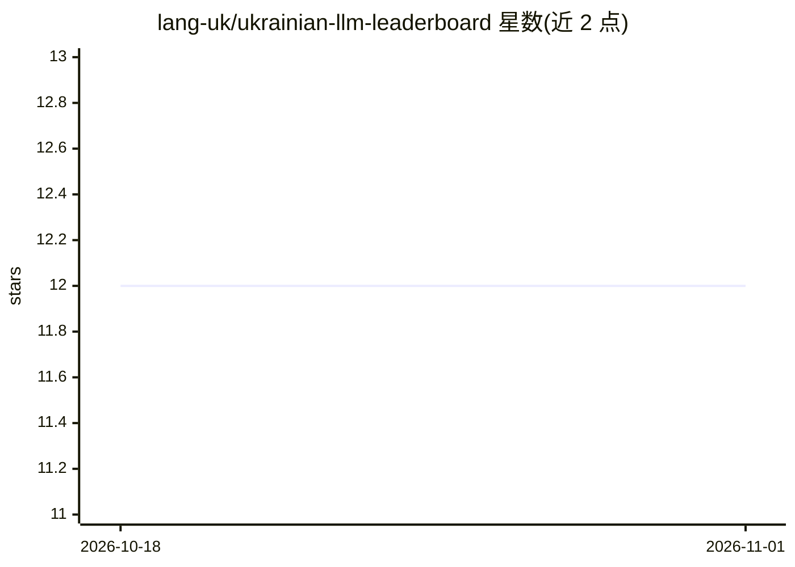

# lang-uk/ukrainian-llm-leaderboard

⭐ 12 · Python · 推送 2026-08-24 · [GitHub](https://github.com/lang-uk/ukrainian-llm-leaderboard) · [官网](https://huggingface.co/spaces/lang-uk/ukrainian-llm-leaderboard) · 组织维护

**乌克兰语 LLM 基准测试排行榜（公平性/翻译/推理等多任务）**

lang-uk 维护的 Gradio 应用，展示各语言模型在乌克兰语基准上的评测结果，数据来自单独的结果数据集。评测覆盖公平性（StereoSet-UK、WinoBias-UK、BBQ-UK 等）、英乌双向机器翻译（FLORES-200、LongFLORES、WMT-22）、摘要、上下文问答、推理与知识、数学（GSM-8K）及指令遵循（IFEval）。提供主榜、公平性对比、详细基准、模型雷达图对比与条形图生成等页面；评测脚本在 GitHub 仓库，用 lm_eval 配合 vllm 运行，多个功能（如 API 提供商接入、量化评测）仍在路线图中未实现。

## 筛选速览

| 维度 | 判定 | 备注 |
|---|---|---|
| AI 角色 | `ai-ecosystem` | LLM/agent 周边工具 |
| 许可风险 | `permissive` | — |
| 部署形态 | `library` | 以包/库形式分发 |
| 模型依赖 | local-ok | 支持本地模型 |
| 硬件要求 | — | 无带数字的原话,不猜 |
| 安装摩擦 | `low` | 无编译、无系统依赖或容器化 |
| 成熟度 | — | 结构信号不足 |

## 能力要点

- 覆盖公平性、机器翻译、摘要、问答、推理、数学、指令遵循 7 类乌克兰语基准
- 支持按指标排序表格、多模型雷达图对比与自定义条形图
- 评测脚本开源，基于 lm_eval + vllm 运行各模型 checkpoint

## 适用场景

- 对比候选模型在乌克兰语任务上的表现以辅助选型
- 查看模型在乌克兰语场景的社会偏见（公平性）指标
- 复现榜单评测或为新模型提交结果

## 场景标签

`模型评测` · 领域:评测与运维

## 证据(README 行号)

> L14: This leaderboard displays performance metrics for language models on Ukrainian language benchmarks as used during d
> L18: The leaderboard evaluates models on a variety of benchmarks covering different NLP tasks in Ukrainian, including:

## 星数曲线

2026-10-18 12 → 2026-11-01 12（+0）

---
*卡片 v1 · prompt 1.4 · 生成 2026-11-01 · 置信度 high · 依据 README sha `0ecc68ca849e` · [字段定义](../../DATASET.md)*
