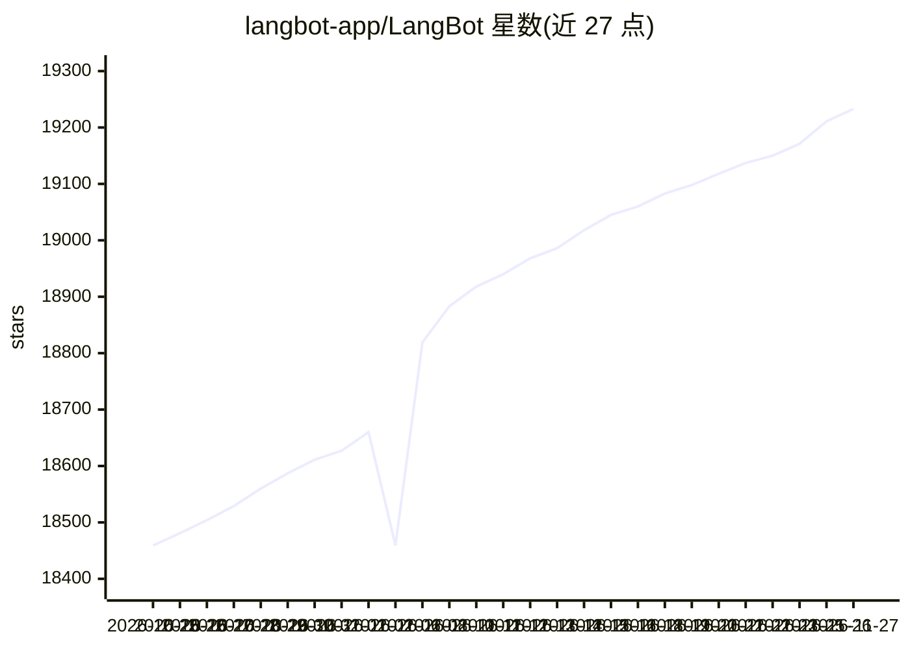

# langbot-app/LangBot

⭐ 19,233 · Python · Apache-2.0 · 推送 2026-11-26 · [GitHub](https://github.com/langbot-app/LangBot) · [官网](https://space.langbot.app/cloud) · 组织维护 · 中文 README

**面向开发者的多平台 IM AI 机器人构建平台**

开源的即时通讯机器人开发平台，将 LLM 接入 Discord、Telegram、Slack、QQ、微信、企业微信、飞书、钉钉等聊天平台，支持多轮对话、工具调用、多模态输出，内置 RAG 知识库并集成 Dify、Coze、n8n、Langflow 等。提供 Web 管理面板做配置与监控，具备访问控制、限流、敏感词过滤等生产机制，插件生态支持 MCP 协议。部署方式包括云服务、一键安装脚本、Docker Compose 及 Zeabur/Railway 云部署。

## 筛选速览

| 维度 | 判定 | 备注 |
|---|---|---|
| AI 角色 | `ai-ecosystem` | LLM/agent 周边工具 |
| 许可风险 | `permissive` | Apache-2.0 |
| 部署形态 | `self-host` | docker 或自建部署 |
| 模型依赖 | local-ok | 支持本地模型 |
| 硬件要求 | — | 无带数字的原话,不猜 |
| 安装摩擦 | `low` | 无编译、无系统依赖或容器化 |
| 成熟度 | — | 结构信号不足 |

## 动量与使用信号

- 维护:`active` — 距上次 push 0.7 天,年发版 60,102 位贡献者
- 涨星:近 1 天 **+28**(自 20261016 起算)
- 平台:— · 协议:MCP / OLLAMA

## 能力要点

- 一个代码库支持 13+ IM 平台（Discord/Telegram/Slack/QQ/微信/飞书/钉钉等）
- 内置 RAG 知识库，深度集成 Dify/Coze/n8n/Langflow
- 内置 MCP Server 与 lbctl CLI，支持 coding agent 编程化管理
- Web 管理面板：消息量、模型调用、成功率实时监控

## 适用场景

- 在 Slack/Discord/Telegram 部署基于自有知识库回答问题的客服机器人
- 将 n8n/Dify 工作流接入企业微信/钉钉实现业务流程自动化
- 用 AI 内容过滤与互动管理 QQ/Discord 社群
- 一个机器人同时覆盖多个聊天平台，统一面板管理

## 场景标签

`聊天机器人` `RAG` · 领域:对话与助手

## 证据(README 行号)

> L28: LangBot is an **open-source, production-grade platform** for building AI-powered instant messaging bots. It connect
> L34: - **AI Conversations & Agents** — Multi-turn dialogues, tool calling, multi-modal support, streaming output. Built-
> L152: - **MCP Server** — LangBot exposes a built-in Model Context Protocol endpoint at `/mcp`, mirroring the HTTP API so

## 星数曲线

2026-10-25 18,459 → 2026-11-27 19,233（+774）

---
*卡片 v1 · prompt 1.4 · 生成 2026-11-22 · 置信度 high · 依据 README sha `f983c8a24368` · [字段定义](../../DATASET.md)*
