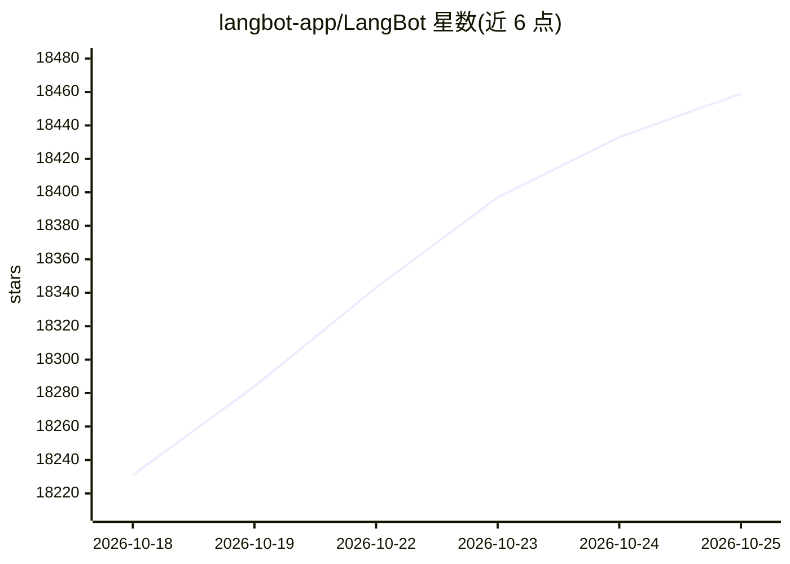

# langbot-app/LangBot

⭐ 18,459 · Python · Apache-2.0 · 推送 2026-10-24 · [GitHub](https://github.com/langbot-app/LangBot) · [官网](https://space.langbot.app/cloud) · 组织维护 · 中文 README

**给开发者的多平台 IM 聊天机器人开发与运行平台**

开源平台，将大语言模型接入 Slack、Discord、Telegram、微信/企业微信、飞书、钉钉、QQ 等 IM 平台，构建能对话、执行任务的智能体。内置 RAG 知识库，深度集成 Dify、Coze、n8n、Langflow 等编排工具；提供 Web 管理面板做配置与监控、插件生态、访问控制与限流。支持 uvx 一行启动、Docker Compose 与多家云平台部署，并通过 MCP Server 与 CLI（lbctl）供编程代理管理机器人、流水线与插件。

## 筛选速览

| 维度 | 判定 | 备注 |
|---|---|---|
| AI 角色 | `ai-native` | 本体是模型或模型工具 |
| 许可风险 | `permissive` | Apache-2.0 |
| 部署形态 | `self-host` | docker 或自建部署 |
| 模型依赖 | local-ok | 支持本地模型 |
| 硬件要求 | — | 无带数字的原话,不猜 |
| 安装摩擦 | `low` | 无编译、无系统依赖或容器化 |
| 成熟度 | — | 结构信号不足 |

## 动量与使用信号

- 维护:`active` — 距上次 push 0.7 天,年发版 60,102 位贡献者
- 涨星:近 1 天 **+28**(自 20261016 起算)
- 平台:— · 协议:MCP / OLLAMA

## 能力要点

- 一套代码接入 Discord、Telegram、Slack、LINE、QQ、微信、企业微信、飞书、钉钉、KOOK 等 IM 平台
- 内置 RAG 知识库，集成 Dify、Coze、n8n、Langflow、Deerflow、Weknora
- 内置 MCP 端点与 lbctl CLI，供编程代理管理机器人、流水线、插件与模型
- 插件生态与事件驱动架构，Web 面板配置无需 YAML

## 适用场景

- 在 Slack/Discord/Telegram 部署基于自有知识库的客服机器人
- 把 n8n/Dify 工作流接入企业微信/钉钉做业务自动化
- 用一个面板统一管理多平台的机器人

## 场景标签

`聊天机器人` `RAG` `工作流自动化` · 领域:效率与自动化

## 证据(README 行号)

> L28: LangBot is an **open-source, production-grade platform** for building AI-powered instant messaging bots. It connect
> L34: - **AI Conversations & Agents** — Multi-turn dialogues, tool calling, multi-modal support, streaming output. Built-
> L144: - **MCP Server** — LangBot exposes a built-in Model Context Protocol endpoint at `/mcp`, mirroring the HTTP API so

## 星数曲线

2026-10-18 18,231 → 2026-10-25 18,459（+228）

---
*卡片 v1 · prompt 1.4 · 生成 2026-10-18 · 置信度 high · 依据 README sha `5d97a7e269a6` · [字段定义](../../DATASET.md)*
