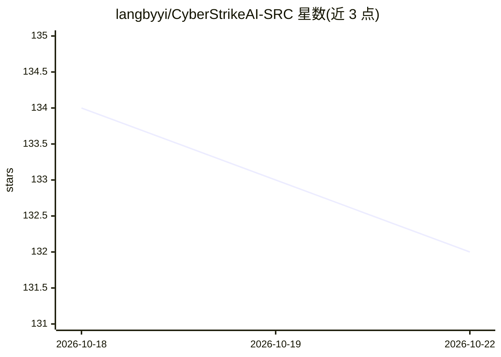

# langbyyi/CyberStrikeAI-SRC

⭐ 132 · Go · Apache-2.0 · 推送 2026-10-17 · [GitHub](https://github.com/langbyyi/CyberStrikeAI-SRC) · 个人维护 · 中文 README

**面向授权 SRC 漏洞挖掘的 AI 原生安全测试平台（Go）**

基于 CyberStrikeAI 的二开分支，Go 实现的 AI 原生安全测试平台：通过 MCP 协议与 AI Agent 把自然语言指令编排为端到端测试流程，覆盖侦察、扫描、漏洞挖掘、攻击链分析与结果可视化。提供 170+ 工具（116 个 YAML 声明 + 55 个内置 MCP）、18 个角色、79 个技能包、RAG 知识库与 Web UI。本分支定向增强 SRC 方向：强制漏洞可复现证据校验、SRC 报告模板、FOFA 多引擎工具、ddddocr 验证码识别，并移除约 20 个治理控制层。需 OpenAI 兼容模型 API，通过 run.sh 从源码编译启动。

## 筛选速览

| 维度 | 判定 | 备注 |
|---|---|---|
| AI 角色 | `ai-native` | 本体是模型或模型工具 |
| 许可风险 | `permissive` | Apache-2.0 |
| 部署形态 | `None` |  |
| 模型依赖 | — | README 未给出锁定关系 |
| 硬件要求 | — | 无带数字的原话,不猜 |
| 安装摩擦 | `low` | 无编译、无系统依赖或容器化 |
| 成熟度 | — | 结构信号不足 |

## 能力要点

- 170+ 工具覆盖 nmap、sqlmap、nuclei、subfinder、fofa_search 等完整 kill chain
- record_vulnerability 落库前校验真实工具探测证据，要求漏洞可复现
- FOFA 多引擎 MCP 工具支持 fofa/quake/shodan/zoomeye 四引擎 + 自然语言转查询语法
- SRC 报告补 9 个提交必备字段，支持 enterprise_src/edusrc/generic 三套模板

## 适用场景

- 授权 SRC 平台上让 AI Agent 执行端到端的漏洞挖掘流程
- 按教育 SRC、企业 SRC、小程序、IoT 等场景使用预设角色与工具集
- 自动化生成含复现证据的 SRC 漏洞提交报告

## 场景标签

`网络安全` · 领域:学习与行业

## 证据(README 行号)

> L9: CyberStrikeAI 是一个 **AI 原生安全测试平台**（Go 实现）：通过 MCP 协议与 AI Agent，把自然语言指令编排成端到端的安全测试流程——从侦察、扫描、漏洞挖掘、攻击链分析到结果可视化，提供可审计、可追溯
> L15: - **AI 决策引擎**：兼容 OpenAI 协议（GPT / Claude / DeepSeek / GLM 等）
> L16: - **170+ 可用工具**（116 个 YAML 声明工具 + 55 个内置 MCP 工具）：覆盖完整 kill chain（nmap、masscan、sqlmap、nuclei、subfinder、fofa_search 等

## 星数曲线

2026-10-18 134 → 2026-10-22 132（-2）

---
*卡片 v1 · prompt 1.4 · 生成 2026-10-22 · 置信度 high · 依据 README sha `0384ac34896e` · [字段定义](../../DATASET.md)*
