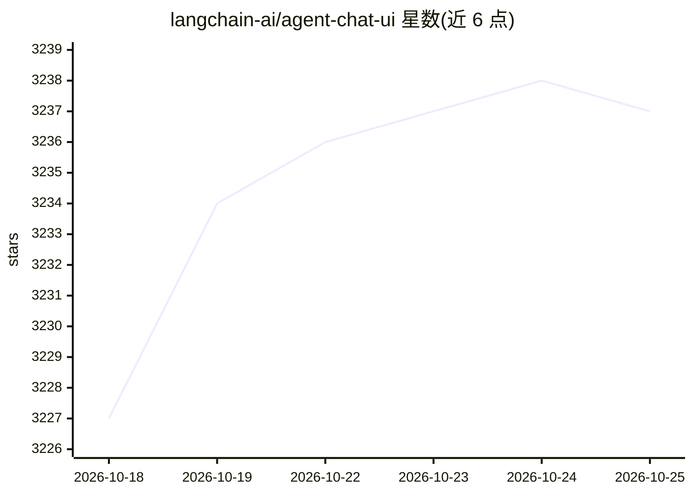

# langchain-ai/agent-chat-ui

⭐ 3,239 · TypeScript · MIT · 推送 2026-10-19 · [GitHub](https://github.com/langchain-ai/agent-chat-ui) · [官网](https://agentchat.vercel.app) · 组织维护

**与任意 LangGraph server 聊天的 Next.js Web 界面**

由 LangChain 团队维护的 Next.js 聊天应用：连接任何带 messages key 的 LangGraph server（Python 与 TypeScript），通过聊天界面提交与获取运行。使用时输入部署 URL、Graph/Assistant ID 与 LangSmith API Key（本地连接可免）。支持通过标签与 id 前缀隐藏流式或永久消息、侧栏渲染 artifacts；生产部署提供 API Passthrough 代理或自定义认证两条路径。可用 npx create-agent-chat-app 初始化或 git clone 后 pnpm 安装运行，也提供在线部署版 agentchat.vercel.app。

## 筛选速览

| 维度 | 判定 | 备注 |
|---|---|---|
| AI 角色 | `ai-ecosystem` | LLM/agent 周边工具 |
| 许可风险 | `permissive` | MIT |
| 部署形态 | `library` | 以包/库形式分发 |
| 模型依赖 | — | README 未给出锁定关系 |
| 硬件要求 | — | 无带数字的原话,不猜 |
| 安装摩擦 | `low` | 无编译、无系统依赖或容器化 |
| 成熟度 | — | 结构信号不足 |

## 能力要点

- 连接任意带 messages key 的 LangGraph server（PY & TS）
- langsmith:nostream 标签与 do-not-render- id 前缀控制消息可见性
- 聊天侧栏渲染 artifacts
- 生产环境提供 API Passthrough 与自定义认证两种方案

## 适用场景

- 为我的 LangGraph agent 提供现成聊天前端
- 本地调试 LangGraph server 的对话交互
- 部署面向多用户的 agent 聊天界面（经 API 代理隐藏密钥）

## 场景标签

`聊天机器人` · 领域:对话与助手

## 证据(README 行号)

> L3: Agent Chat UI is a Next.js application which enables chatting with any LangGraph server with a `messages` key throug
> L45: - **Deployment URL**: The URL of the LangGraph server you want to chat with. This can be a production or developmen

## 星数曲线

2026-10-18 3,227 → 2026-10-25 3,237（+10）

---
*卡片 v1 · prompt 1.4 · 生成 2026-10-20 · 置信度 high · 依据 README sha `5464fab86f65` · [字段定义](../../DATASET.md)*
