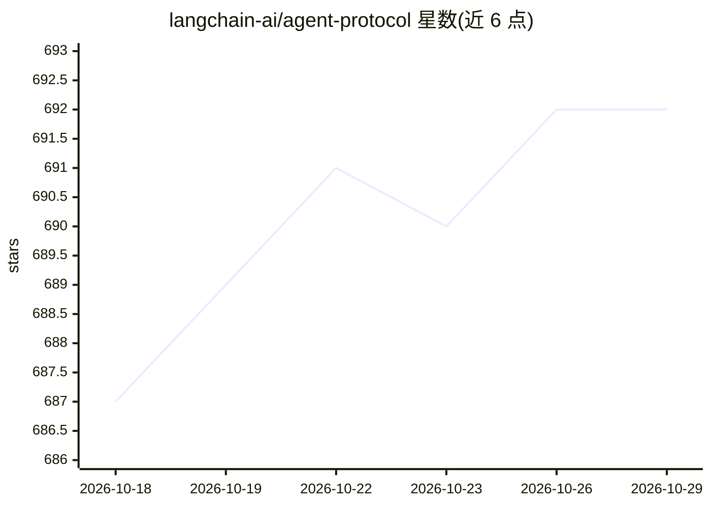

# langchain-ai/agent-protocol

⭐ 692 · Python · MIT · 推送 2026-10-26 · [GitHub](https://github.com/langchain-ai/agent-protocol) · [官网](https://langchain-ai.github.io/agent-protocol/api.html) · 组织维护

**框架无关的 LLM agent 生产服务 API 协议规范**

由 LangChain 团队维护的开放协议规范：定义生产环境部署 LLM agent 所需的框架无关 REST API，围绕 Runs（一次性/后台执行）、Threads（多轮交互与状态历史）、Store（长期记忆）、Agents（内省）、Streaming（SSE/WebSocket 流式原语）等端点组织，并提供 OpenAPI 文档、JSON 规范、CDDL 流式 schema 及生成的 Python/TypeScript 绑定与 FastAPI 服务器桩。LangGraph Platform 实现其超集，另有 LangGraph.js 与自托管子 agent 示例实现，社区可自行实现。

## 筛选速览

| 维度 | 判定 | 备注 |
|---|---|---|
| AI 角色 | `ai-ecosystem` | LLM/agent 周边工具 |
| 许可风险 | `permissive` | MIT |
| 部署形态 | `None` |  |
| 模型依赖 | — | README 未给出锁定关系 |
| 硬件要求 | — | 无带数字的原话,不猜 |
| 安装摩擦 | `low` | 无编译、无系统依赖或容器化 |
| 成熟度 | — | 结构信号不足 |

## 能力要点

- 定义 Runs/Threads/Store/Agents/Streaming 五类 API 端点规范
- 提供 OpenAPI 文档、JSON 规范与 CDDL 流式 schema
- 生成 Python（Pydantic V2 + FastAPI）与 TypeScript 绑定
- 附 Hurl 格式的用户旅程示例演示 API 调用序列

## 适用场景

- 为自研 agent 服务设计统一的对外 API 规范
- 参考实现可互操作的 agent 服务端与客户端
- 按协议接入 LangGraph.js 等既有实现部署 agent

## 场景标签

 · 领域:LLM 基础设施/agent 服务

## 证据(README 行号)

> L3: Agent Protocol is our attempt at codifying the framework-agnostic APIs that are needed to serve LLM agents in produc
> L22: What is the right API to serve an LLM application in production? We believe it’s centered around 3 important concep

## 星数曲线

2026-10-18 687 → 2026-10-29 692（+5）

---
*卡片 v1 · prompt 1.4 · 生成 2026-10-21 · 置信度 high · 依据 README sha `f8995e766ee0` · [字段定义](../../DATASET.md)*
