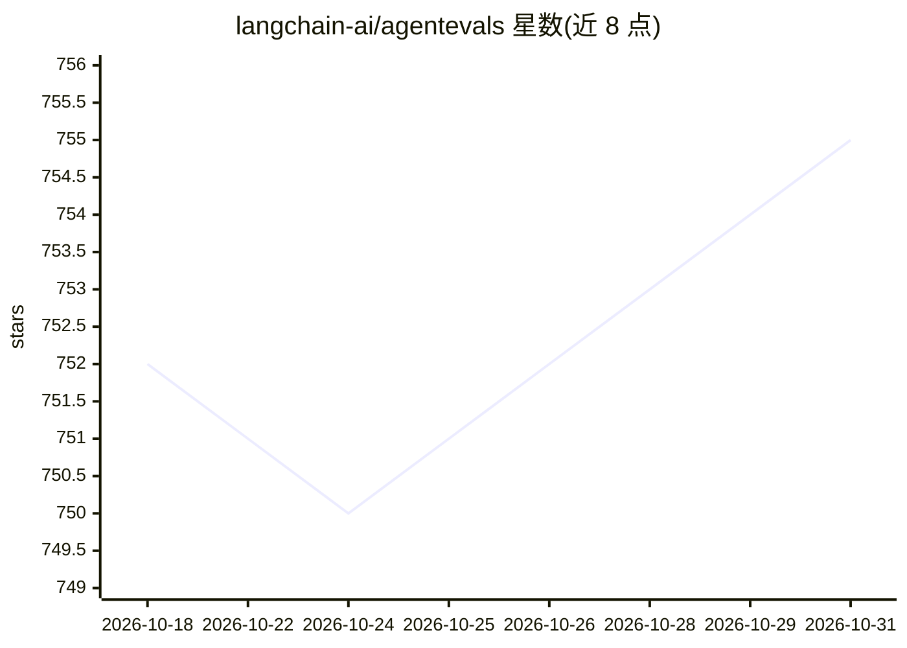

# langchain-ai/agentevals

⭐ 755 · Python · MIT · 推送 2026-07-14 · [GitHub](https://github.com/langchain-ai/agentevals) · 组织维护

**面向开发者的 agent 轨迹评测库：现成评估器打分**

LangChain 团队维护的 Python/TypeScript 库，提供针对 agent 执行轨迹的评测器集合，轨迹以 OpenAI 格式消息列表或 LangChain BaseMessage 表示。包含轨迹匹配评估器（strict/unordered/subset/superset 四种模式，可配置工具参数匹配策略与自定义比较函数）与 LLM-as-judge 轨迹评估器（无需参考轨迹，可选连续分数）。LLM 评估默认使用 LangChain chat model 集成（预装 langchain_openai），也可直接用 OpenAI 客户端。姊妹包为更通用的 openevals。

## 筛选速览

| 维度 | 判定 | 备注 |
|---|---|---|
| AI 角色 | `ai-ecosystem` | LLM/agent 周边工具 |
| 许可风险 | `permissive` | MIT |
| 部署形态 | `library` | 以包/库形式分发 |
| 模型依赖 | — | README 未给出锁定关系 |
| 硬件要求 | — | 无带数字的原话,不猜 |
| 安装摩擦 | `low` | 无编译、无系统依赖或容器化 |
| 成熟度 | — | 结构信号不足 |

## 能力要点

- strict/unordered/subset/superset 四种轨迹匹配模式
- 工具参数匹配可配置：ignore/subset/superset 或按工具名自定义比较函数
- LLM-as-judge 轨迹评估无需参考轨迹，支持 continuous 连续分数与 choices 自定义分值
- Python 与 TypeScript 双语言支持

## 适用场景

- 验证 agent 是否按预期顺序调用了指定工具
- 在允许调用顺序灵活的前提下校验关键工具是否被调用
- 用 LLM 评审 agent 轨迹的合理性并纳入回归测试

## 场景标签

`模型评测` · 领域:评测与运维

## 证据(README 行号)

> L7: This package contains a collection of evaluators and utilities for evaluating the performance of your agents, with a
> L92: For LLM-as-judge evaluators, you will also need an LLM client. By default, `agentevals` will use LangChain chat mod

## 星数曲线

2026-10-18 752 → 2026-10-31 755（+3）

---
*卡片 v1 · prompt 1.4 · 生成 2026-10-21 · 置信度 high · 依据 README sha `a537067cf4e1` · [字段定义](../../DATASET.md)*
