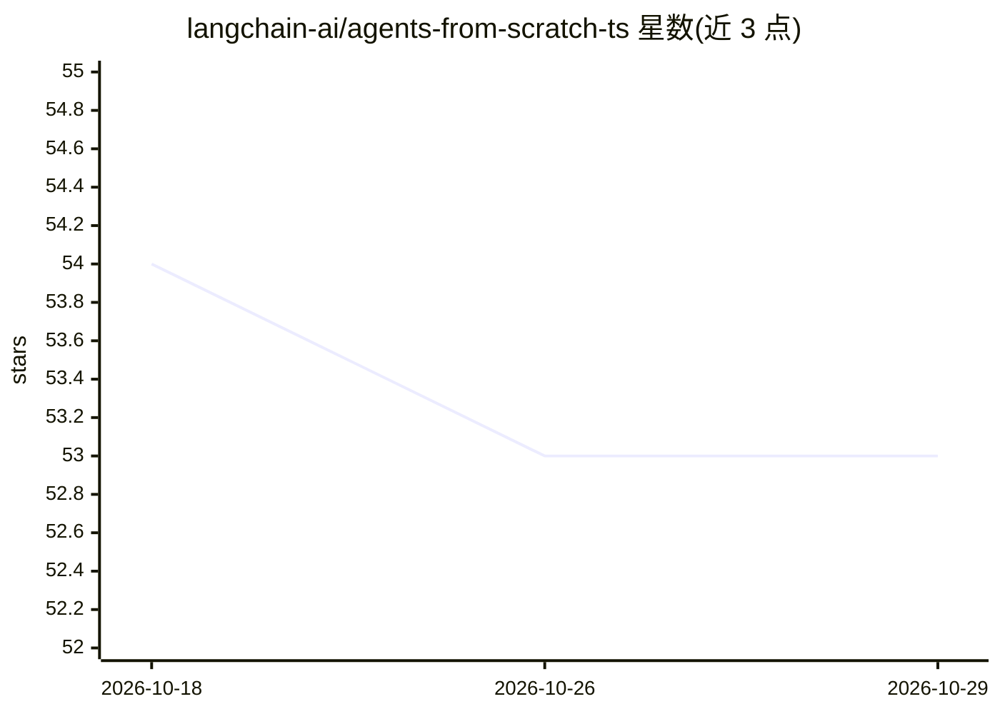

# langchain-ai/agents-from-scratch-ts

⭐ 53 · Jupyter Notebook · 推送 2026-10-21 · [GitHub](https://github.com/langchain-ai/agents-from-scratch-ts) · 组织维护

**LangGraph.js 邮件助手教程仓库：HITL 与记忆的渐进实现**

基于 LangGraph.js 的 AI 邮件助手示例工程，含三个递进版本：基础分诊与回复助手、带 Human-in-the-Loop 中断人工审核的版本、再加持久记忆从用户反馈学习偏好的版本。配套 4 个 TypeScript Jupyter 笔记本逐步讲解构建过程，可用 LangGraph Studio 可视化运行调试。运行需 Node.js v18+、OpenAI API key，通过 npm 安装依赖、npm run agent 启动；记忆存储用 InMemoryStore，可替换为其他持久化存储。

## 筛选速览

| 维度 | 判定 | 备注 |
|---|---|---|
| AI 角色 | `ai-knowledge` | 知识聚合/清单类 |
| 许可风险 | `none` | — |
| 部署形态 | `library` | 以包/库形式分发 |
| 模型依赖 | — | README 未给出锁定关系 |
| 硬件要求 | — | 无带数字的原话,不猜 |
| 安装摩擦 | `low` | 无编译、无系统依赖或容器化 |
| 成熟度 | — | 结构信号不足 |

## 能力要点

- 三个递进实现：基础助手 → HITL 人工审核/编辑/反馈 → 持久记忆学习偏好
- 4 个 TypeScript Jupyter 笔记本（langgraph_101/agent/hitl/memory）
- LLM 三分类邮件分诊（respond/notify/ignore）与工具调用中断审核
- 可用 LangGraph Studio 可视化运行与调试，附完整测试场景说明

## 适用场景

- 学习用 LangGraph.js 构建带人工审核的 agent
- 了解 agent 记忆如何从人工编辑与反馈中更新偏好
- 作为邮件助手原型在 LangGraph Studio 中交互测试

## 场景标签

`教程课程` `Agent 记忆` · 领域:Agent 开发

## 证据(README 行号)

> L3: This repository contains implementations of AI email assistants built using LangGraph.js, a library for building sta
> L48: multiple interactive Typescript Jupyter notebooks to go through the process of creating these agentic features.

## 星数曲线

2026-10-18 54 → 2026-10-29 53（-1）

---
*卡片 v1 · prompt 1.4 · 生成 2026-10-24 · 置信度 high · 依据 README sha `0931ef43fe4e` · [字段定义](../../DATASET.md)*
