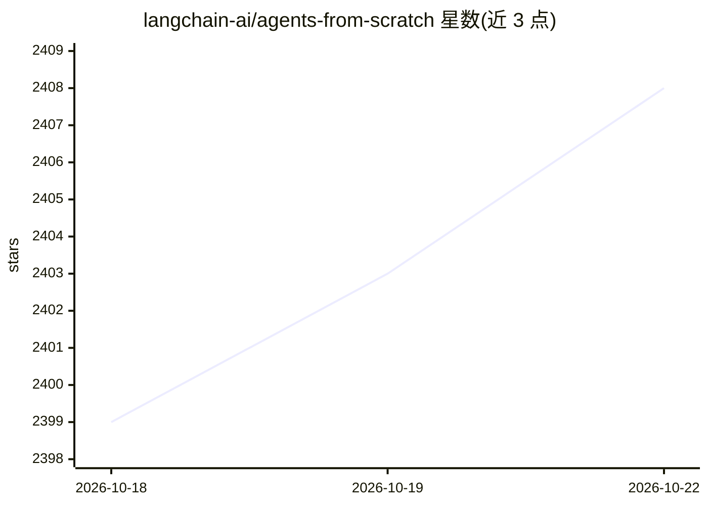

# langchain-ai/agents-from-scratch

⭐ 2,408 · Jupyter Notebook · MIT · 推送 2026-08-11 · [GitHub](https://github.com/langchain-ai/agents-from-scratch) · [官网](https://academy.langchain.com/courses/ambient-agents) · 组织维护

**从零构建邮件助手 agent 的教程仓库：评测、人机协作与记忆**

LangGraph 官方团队的实践教程：分 4 个 notebook 逐步构建一个能管理邮件的 ambient agent——先实现邮件分类加回复 agent，再做基于 Pytest 与 LangSmith evaluate API 的评测（含 LLM-as-a-judge、工具调用与分类判定），随后通过 Agent Inbox 加入人工审批（human-in-the-loop），最后用 LangGraph Store 持久化记忆以学习用户偏好。默认使用 mock 邮件/日历工具，另提供 Gmail API 对接与 LangGraph Platform 部署说明，及自动化测试套件。需要 Python 3.11+、OpenAI 与 LangSmith API key。

## 筛选速览

| 维度 | 判定 | 备注 |
|---|---|---|
| AI 角色 | `ai-knowledge` | 知识聚合/清单类 |
| 许可风险 | `permissive` | MIT |
| 部署形态 | `library` | 以包/库形式分发 |
| 模型依赖 | — | README 未给出锁定关系 |
| 硬件要求 | — | 无带数字的原话,不猜 |
| 安装摩擦 | `low` | 无编译、无系统依赖或容器化 |
| 成熟度 | — | 结构信号不足 |

## 能力要点

- 4 个 notebook 递进覆盖 agent 构建、评测、human-in-the-loop 与记忆
- 使用 LangSmith evaluate API 与 LLM-as-a-judge 做回复/工具调用/分类评测
- Agent Inbox 界面支持人工审批工具调用（发邮件、安排会议等）
- 基于 LangGraph Store 的记忆持久化与 Gmail 集成、LangGraph Platform 部署

## 适用场景

- 学习如何从零搭建带评测与人工审批的 LangGraph agent
- 为已有的邮件/日程类 agent 添加记忆与 human-in-the-loop 机制
- 参考其测试套件做法对 agent 做自动化评测

## 场景标签

`教程课程` · 领域:学习与行业

## 证据(README 行号)

> L3: The repo is a guide to building agents from scratch. It builds up to an "ambient" agent that can manage your email w
> L73: The repo is organized into the 4 sections, with a notebook for each and accompanying code in the `src/email_assista

## 星数曲线

2026-10-18 2,399 → 2026-10-22 2,408（+9）

---
*卡片 v1 · prompt 1.4 · 生成 2026-10-21 · 置信度 high · 依据 README sha `e06bed137faf` · [字段定义](../../DATASET.md)*
