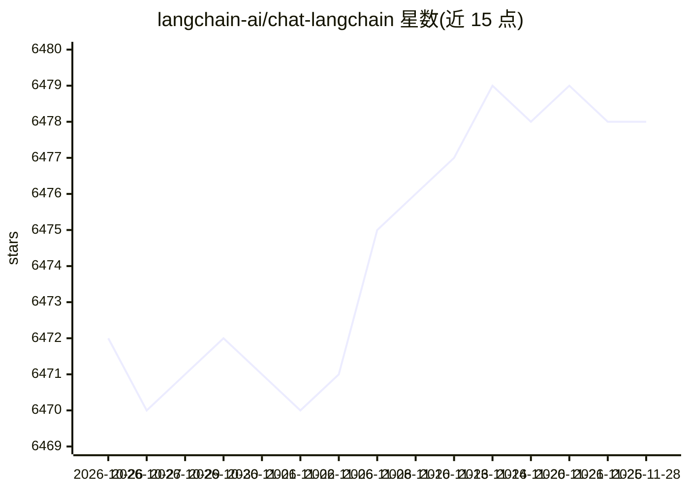

# langchain-ai/chat-langchain

⭐ 6,478 · Python · MIT · 推送 2026-11-27 · [GitHub](https://github.com/langchain-ai/chat-langchain) · [官网](https://chat.langchain.com) · 组织维护

**回答 LangChain 文档问题的文档助手 Agent 参考实现**

langchain-ai 官方的文档问答助手 Agent，回答关于 LangChain、LangGraph、LangSmith 的问题，以 Managed Deep Agent 形式部署。工作流为：守卫校验问题相关性→经 managed MCP 连接器检索官方文档→检索 Pylon 知识库中的已知问题→生成回答→自动校验回答中的 URL。后端为 Python（uv/pip），前端为 Next.js 聊天界面，经 Supabase 做登录与匿名用户身份认证。仓库同时作为构建生产级 Agent 的示例。

## 筛选速览

| 维度 | 判定 | 备注 |
|---|---|---|
| AI 角色 | `ai-native` | 本体是模型或模型工具 |
| 许可风险 | `permissive` | MIT |
| 部署形态 | `None` |  |
| 模型依赖 | — | README 未给出锁定关系 |
| 硬件要求 | — | 无带数字的原话,不猜 |
| 安装摩擦 | `low` | 无编译、无系统依赖或容器化 |
| 成熟度 | — | 结构信号不足 |

## 能力要点

- docs-first 研究策略：文档检索→KB 检索→生成→链接校验五步流水线
- Guardrails 过滤偏离主题的查询
- 经 managed MCP 连接器检索官方 LangChain 文档
- Supabase 身份认证，MDA 校验令牌并按用户隔离线程

## 适用场景

- 查阅 LangChain/LangGraph/LangSmith 文档并核对链接有效性
- 作为参考实现搭建自己的文档问答 Agent
- 了解 Managed Deep Agents 的部署与身份管理方式

## 场景标签

`文档问答` `RAG` · 领域:知识与检索

## 证据(README 行号)

> L11: This is a documentation assistant agent that helps answer questions about LangChain, LangGraph, and LangSmith. It d
> L98: 1. **Guardrails Check** - Validates the query is LangChain-related
> L101: 4. **Response Generation** - Synthesizes a helpful answer

## 星数曲线

2026-10-26 6,472 → 2026-11-28 6,478（+6）

---
*卡片 v1 · prompt 1.4 · 生成 2026-11-22 · 置信度 high · 依据 README sha `6cdcc7b049af` · [字段定义](../../DATASET.md)*
